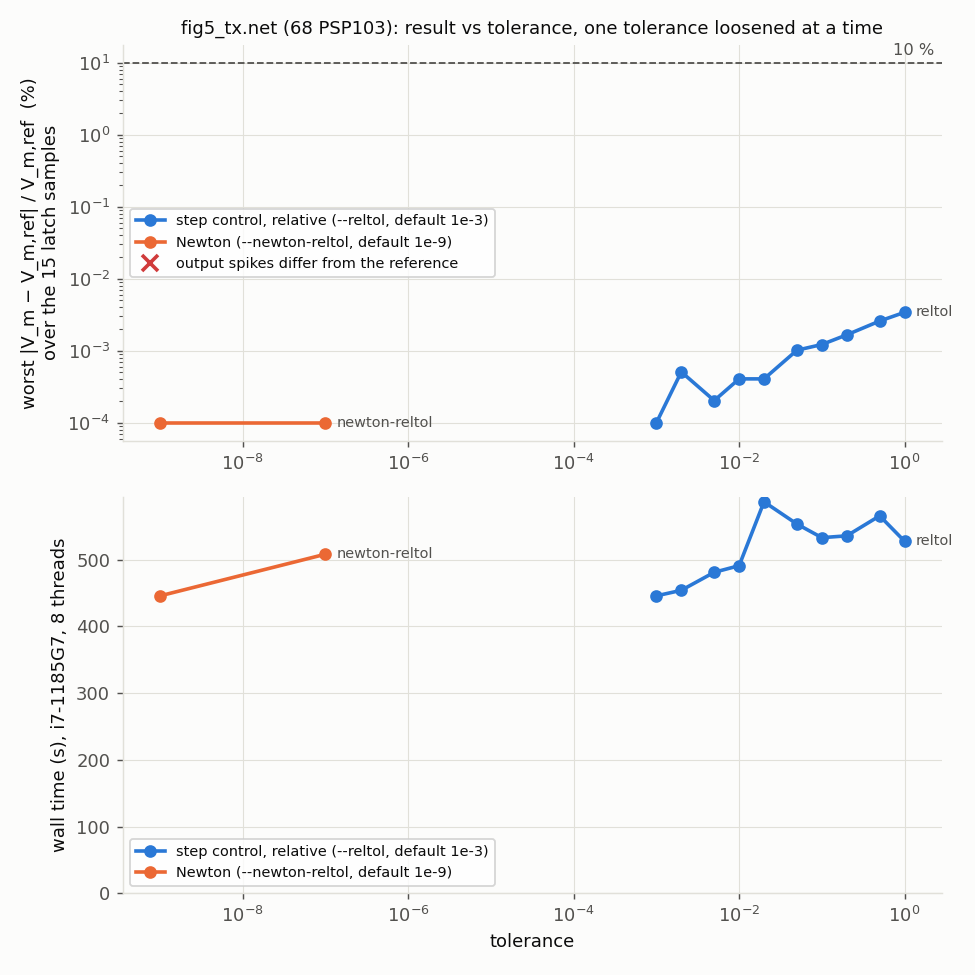

# The SNN with real transistors

The decks in `circuits/snn/` and `circuits/snn/mnist/` simulate the Xuan et al. (IJCNN 2026)
SNN with **no transistor model**. The crossbar's access transistors and the neuron's clocked
switches are ideal smooth switches (`vswitch.va`, R_on = 10 Ω), and the op-amp, attenuator,
comparator and reset logic are ideal behavioural blocks. This directory replaces those
idealisations with MOS devices, one step at a time.

## How the technology is swapped

Every MOS device in these decks comes from `tech.py`. A generator asks it for device lines, and
it writes one `.model` card per geometry into the deck's `tech.inc`. The decks never name a
process. The only backend today is **`sg13g2_hv`**: IHP's SG13G2 open-PDK thick-oxide 3.3 V
devices through the PDK's own PSP103 (`models/sg13g2/`, typical corner, not validated against a
reference simulator). When the foundry's SG13S + MEMRES models arrive, they become a second
backend, and the decks are regenerated with `--tech`. A run names both libraries:

    va-cli sim <deck> --model models/snn --model models/sg13g2/psp103/psp103.va --tran

(`--model` repeats since 2.3.0, and each library resolves its own `` `include ``s.)

## Steps

| Step | Deck | State |
|---|---|---|
| 1. Access transistors in the Fig. 5 deck | `fig5_access.net` (`gen_fig5_access.py`) | **runs**, first measurements below |
| 2. The neuron at transistor level (Fig. 2's blocks, designed and sized by us: the paper gives no sizes and draws the op-amp and flip-flop as boxes) | `fig5_tx*.net` (`gen_neuron.py`) | **runs** (2.5.0), every block; measurements below |
| 3. Wall-time projection to the MNIST network, and the optimisations it calls for | — | next |
| 4. A behavioural switch fitted to the transistor, for training (rung A) | `fig5_fit.net` (`gen_fig5_access.py --switch fit`, `fit_switch.py`) | **runs** (2.21.0), Fig. 5 only; measurements below |

`uic_access.net` is one 2T2R branch started cold, kept as va-cli's regression deck for the
seed rule (below).

## First measurements (2026-10-01, i7-1185G7, 8 threads, 2.3.0)

**The access transistor is not a 10 Ω switch.** Its source sits on the source line at
V_ref = 1.65 V with the bulk at ground, so it has 1.65 V of gate drive and a large body effect.
Measured R_on (W = 10 µm unless stated, L = 0.45 µm, V_GS = 1.65 V, V_SB = 1.65 V):

| W | R_on | vs LRS1 (8 kΩ) |
|---|---|---|
| 1 µm | 3681 Ω | 46 % |
| 2 µm | 1759 Ω | 22 % |
| 5 µm | 731 Ω | 9.1 % |
| 10 µm | 377 Ω | 4.7 % |

So every synaptic conductance is really 1/(R_cell + R_on), and the codebook shifts with it.
`fig5_access.net` uses W = 10 µm (`--w`). Its output spikes are still at **steps 6, 10, 14**,
as in the paper. V_m departs from the paper's equations by up to **0.131 V** (the ideal-switch
deck: 0.012 V), and `check_snn.py fig5` reports FAIL against its 0.05 V tolerance. That
tolerance was written for ideal switches. The departure is the R_on effect, not an error. The
remedy is to put R_on into the codebook the training quantizes to, not to loosen the tolerance.

**Wall time** for the same 3.75 µs (15 clock cycles):

| | unknowns | timepoints | wall (8 threads) | wall (1 thread) |
|---|---|---|---|---|
| `fig5_neuron.net` (ideal switches) | 80 | 10 707 | 4.0 s | — |
| `fig5_access.net` (8 PSP103) | 208 | 13 645 | 64.3 s | 115.5 s |

The timepoint count grows 1.3×, and the cost per timepoint grows 12×. About 8.5 ms per
timepoint single-threaded puts **one PSP103 evaluation at roughly 200 µs**. That is the number to
attack before the MNIST network (17 664 access transistors) is worth attempting at transistor
level. One structural lever is visible already: in a spiking network most word lines are low
most of the time, so most access transistors sit at a constant bias between steps, and SPICE's
device bypass (reuse a device's stamps when its terminal voltages have not moved) would skip
them.

## The seed rule (va-transient, 2.3.0)

Every one of these decks starts from rest (`UIC`), because the flip-flops need it. The first
run of `fig5_access.net` ended at t = 0 with a timestep underflow. A PSP103's internal source
node carries charge but is tied to the 1.65 V source line through the device's terminal
resistance, so from the zero seed it has to jump at every step size, and the LTE controller
shrank to the floor. The step at the floor is exactly the t = 0+ solution UIC means (charges
held, everything else settled), so it is now accepted there, on the first step only, followed
by a restart. Runs that integrated before are bit-identical: `xtask validate` 28/28 and
Fig. 4, Fig. 5, the PSP103 inverter and c17_tran give identical outputs before and after.

## The neuron at transistor level (2026-10-02, i7-1185G7, 8 threads, 2.5.0)

`gen_neuron.py` writes the Fig. 5 deck (access transistors as in `fig5_access.net`) with any
subset of the neuron's four blocks as SG13G2 transistors, the rest behavioural. The neuron is
the MNIST decks' form: refractory off, one flip-flop. **Every design and size below is ours.**
The paper gives the topology of Fig. 2 and no sizes, so none of this reproduces the authors'
circuit. It shows that a circuit of this shape works in this technology.

| Block | What it is | Where it departs from Fig. 2, and why |
|---|---|---|
| `switches` | leak transmission gate V_m ↔ C_L on qclk; NMOS discharge of C_L on clk; NMOS reset to V_reset on rs | The leak is a TG, not the single NMOS MN9: V_m reaches ~2.4 V, and an NMOS with its gate at 3.3 V and its bulk at ground passes little above ~2.2 V |
| `comparator` | NMOS-input 5T comparator against an explicit V_th = 2.4 V (tail from V_bn = 0.8 V, ~4.4 µA), two inverters | Not the Schmitt trigger: its threshold is set indirectly and needs sizes the paper does not give. No hysteresis; the flip-flop reads it at the end of a high phase, where V_m is settled |
| `dff` | master–slave TGs on clk/qclk onto 10 fF hold caps, inverters; reset rs = (m0·clkb) + (q0·clk) as an AOI22 + inverter | The power-on term is dropped (por is 0 in these decks) |
| `input` | holds the source line at V_ref and delivers I_in / K into V_m while clk is high: a two-stage op-amp drives a PMOS conveyor that sinks I_b + I_in, mirrors scale by 1/K, cascoded outputs, a trimmed I_b/K sink, steering onto V_m or onto a follower that tracks V_m | Fig. 2's push-pull conveyor has a dead zone at I_in = 0, across which the op-amp would have to slew ~1.4 V on every sign change; the bias current I_b removes it. `input_stage.py` carries the reasoning and the measured accuracy |

All biases (V_bn, V_bp, the cascode biases and the input stage's trim) are global ideal sources,
and every DC source powers up over 1 ns: under UIC, a PMOS gate or bulk on a source that is
already at 3.3 V at t = 0 has to charge PSP103's internal nodes through ohms into femtofarads,
faster than the step floor.

**The ladder.** Each rung adds one block. Run with
`va-cli sim <deck> --model models/snn --model models/sg13g2/psp103/psp103.va --tran --report clk,wl1,vm,spk`,
checked with `check_snn.py fig5`, all on the 2.5.0 release binary:

| Deck | Transistor blocks | PSP103 devices | Unknowns | Timepoints | Wall | Worst \|V_m − equations\| | Output spikes |
|---|---|---|---|---|---|---|---|
| `fig5_access.net` | none (access only) | 8 | 208 | 13 641 | 24.7 s | 0.1305 V | 6, 10, 14 |
| `fig5_tx_none.net` | none | 8 | 186 | 12 940 | 24.0 s | 0.1305 V | 6, 10, 14 |
| `fig5_tx_sw.net` | switches | 12 | 250 | 17 916 | 67.0 s | 0.1462 V | 6, 10, 14 |
| `fig5_tx_cmp.net` | + comparator | 21 | 397 | 18 560 | 110.8 s | 0.1558 V | 6, 10, 14 |
| `fig5_tx_dff.net` | + flip-flop and reset logic | 43 | 750 | 23 513 | 282.6 s | 0.1558 V | 6, 10, 14 |
| `fig5_tx_in.net` | input stage only | 33 | 605 | 16 997 | 167.2 s | 0.1472 V | 6, 10, 14 |
| **`fig5_tx.net`** | **all four** | **68** | **1169** | **23 786** | **443.9 s** | **0.1733 V** | **6, 10, 14** |

The output spikes are the paper's at every rung. The V_m error is measured against the paper's
equations with ideal switches, and 0.1305 V of it is the access transistors' R_on (first row;
see above), so `check_snn.py`'s 0.05 V tolerance reports FAIL throughout, for the reason given
there. What each block adds to the worst error: the switches +16 mV, the comparator +10 mV, the
flip-flop nothing measurable, the input stage +17 mV alone and +18 mV on the full neuron. (Where
the switches' and the comparator's shares come from -- R_on, charge injection, input
capacitance -- has not been separated.)

**The input stage, in numbers** (`bench_input_stage.py`, `scan_input_stage.py`,
`scan_point.py`): DC gain 1.429 at I_in = +10 µA and 1.448 at −10 µA against 1/K = 1.4368
(curvature in I_in, ±0.7 %), flat to 0.1 % over V_m = 0.45–2.4 V; |I_out| at I_in = 0 under
0.24 µA over the same range after the V_bs trim; the source line held at V_ref + 0.09 mV.
Against the behavioural `sl_stage` in the same deck (`fig5_tx_in` vs `fig5_tx_none`), V_m differs
by at most 20 mV per step: the integration slope is 0.7 % low at I_in ≈ 5.8 µA and 1.9 % low at
≈ 9 µA, and the switch edges add 10–19 mV at low V_m. Four things were found and fixed on the way
to that, in the transient deck rather than the DC bench:

  * the complementary clock clkb was written as a pulse starting low, so clk and clkb were both
    low for the first 124 ns, and the steering's PMOS put 0.26 V on V_m before the first window.
    `gen_neuron.py` now writes clkb as the exact complement of clk after the 1 ns power-up;
  * the op-amp had a 1.5 mV systematic offset (second-stage current density 2.5× the first's),
    1.6 % of V_s = 0.1 V; resized, 0.09 mV;
  * the output node's capacitance (~34 fF with the cascodes as wide as the mirrors) waited at
    V_ref between windows and shared charge with C_M at every window start: a 25–40 mV step
    toward V_ref per cycle, an extra leak. Narrower cascodes alone took it only to ~24 fF; the
    output now waits on a follower that tracks V_m (a 5-transistor PMOS-input OTA), so there is
    nothing to share;
  * during a window that capacitance (~12 fF after the above) still sits in parallel with C_M,
    so the mirror is made stronger by 1 + C_o / C_M (`C_O_TRIM`, measured from the slope).

**Cost.** The full neuron takes 18× the access-only deck's wall time for 8.5× the devices and
1.7× the timepoints. The MNIST projection (step 3) starts from these numbers.

## Breakpoint slivers (va-transient, 2.5.0)

The first full-neuron run with the follower ended at t = 1.372 µs in a timestep underflow, with
Newton failing at every step size down to the floor and its residual stuck at exact powers of
two (2⁻²⁰, 2⁻²¹, 2⁻²² A) on PSP103 internal rows. The cause was not the circuit: the run had landed on
a source corner at 1.3720000000000002e-6 s, and a model then registered a breakpoint at the
same corner one ulp later, so every attempt was clamped to a 2.1e-22 s step. A companion
coefficient of 4.7e21 makes the charge terms ~5.7e7, whose rounding is the residual. A breakpoint
less than the step floor after the current time is now treated as the instant already landed on.
Three existing decks took such slivers: `fig4_neuron`, `fig5_neuron` and `fig5_access` lose 2–4
timepoints each, all sub-floor duplicates of a corner, and every V_m sample their checks read is
unchanged at the printed precision (`check_snn.py` PASS with identical numbers for Figs. 4 and 5).

## Tolerance study (2026-10-02, 2.6.0)

`tolerance_study.py` reruns `fig5_tx.net` (68 PSP103) with one transient tolerance loosened at
a time (`va-cli --reltol`, `--newton-reltol`, new in 2.6.0) and compares V_m at the 15 latch
samples, and the output spikes, with the default-tolerance run. Figure: `tolerance_study.png`;
data: `tolerance/results.jsonl`.

- **`--reltol` from 1e-3 to 1: V_m moves by at most 0.003 %, the spikes never change, and no run
  is faster.** The reference takes 445.6 s; every looser run takes 454–587 s, with 5–38 % fewer
  timepoints. Longer steps cost more Newton work than the timepoints they save, and the 10 %
  limit the study was to search for is never approached. On this deck, step-control tolerance
  is not where the time goes.
- `--newton-reltol 1e-7`: identical V_m, 508 s. The study was stopped there, by choice, before the
  rest of the Newton sweep and the `--abstol` sweep (which the script also carries) ran.

## Crossbar timing (2026-10-02, 2.6.0)

`gen_mnist_tx.py` turns an MNIST digit deck (`circuits/snn/mnist/decks/`) into a transistor-level
one: each 2T2R cell's access devices as SG13G2 NMOS, the neurons as transistors or kept
behavioural (`--neurons`), any subset of the layers and neurons (`--layers`, `--per-layer`).
**It measures cost, not classification:** the network was trained with an unbounded V_m
(`circuits/snn/mnist/README.md`), so a transistor-level run is not expected to classify the same.

**The whole network** (digit 0, every synapse and neuron as transistors): 25 944 PSP103, 44 515
devices, **437 480 unknowns**. A 5 ns run had not finished after 10 min and was stopped.

**The hidden-2 crossbar, scaled** (digit 0's real h1 input spike trains, behavioural neurons,
2 cycles = 500 ns, i7-1185G7, 8 threads, run one at a time). Plain is this release; bypass is the
`proto/static-bypass` prototype (2.4.0 + device bypass, `VA_BYPASS=on`; on main as `--bypass` since
2.7.0, where `docs/proposals/device-bypass.md` §6 breaks the 64-neuron bypass run down by phase):

| Neurons | Access NMOS | Unknowns | Timepoints | Plain | Bypass (loads replayed) | Plain µs / device / point | Bypass µs / device / point |
|---|---|---|---|---|---|---|---|
| 8 | 1 024 | 17 710 | 1 383 | 255 s | 70 s (90.2 %) | 180 | 49 |
| 16 | 2 048 | 35 262 | 1 385 | 445 s | 157 s (90.0 %) | 157 | 55 |
| 32 | 4 096 | 70 366 | 1 399 | 883 s | 407 s (90.0 %) | 154 | 71 |
| 64 | 8 192 | 140 574 | 1 411 | 1 909 s | 1 289 s (90.1 %) | 165 | 111 |

- **Plain cost is linear in the device count**, ~160 µs per access transistor per timepoint, and
  the timepoint count hardly changes with size. The 64-neuron run peaked at 3.4 GB.
- **Bypass is exact here and its gain shrinks with size**: 3.6× → 2.8× → 2.2× → 1.5×. V_m of the
  8 neurons at the end of each cycle is identical to the plain run's to 4 decimals. With 90 % of
  the loads replayed at every size, what is left grows ~3.2× per doubling at the top: the part
  of each step that is not device evaluation scales superlinearly. *(Measured 2026-10-03, 2.7.0:
  **not the sparse factorisation**, which is 5 % of the 64-neuron run. Stamping into the matrix,
  serial and hash-based, grows 12× for 8× the devices, and a fresh device evaluation 7.8 → 60 µs,
  the larger part and not yet explained — `docs/proposals/device-bypass.md` §6.)*

**Projection, an extrapolation and labelled as one.** The network's three crossbars hold 17 664
access transistors, 2.16× the 64-neuron crossbar. At the plain rate that is ~2.9 s per timepoint;
the behavioural MNIST run took ~2 200 timepoints per cycle (here ~700 in the first two cycles),
so 29 cycles are 20 000–64 000 timepoints, **~16–52 h per image for the crossbars alone with
behavioural neurons**, on the condition that the superlinear part seen under bypass stays small
beyond 140k unknowns, which nothing here shows. The transistor neurons would add 8 280 devices,
and on the single-neuron deck they multiplied the timepoints by 2.2.

## A switch fitted to the transistor (2026-10-08, Xeon 2.8 GHz, 2.21.0)

Training cannot run at transistor level (`docs/proposals/snn-transistor-performance.md` §4.6),
so the transistor has to come back into the behavioural model the training uses. The idea is a
switch with as few parameters as the circuit allows, fitted to PSP103, built in rungs: each rung
adds a parameter only once the one before it is shown to be short.

| Rung | Model | Parameters | State |
|---|---|---|---|
| A | g = beta * ns * ln(1 + exp((V_GS - vt) / ns)), I = g * V_DS | beta, vt (+ ns from the subthreshold slope) | **done**: `models/snn/mos_switch.va` |
| B | + the triode V_DS term | +0-1 | not needed yet (below) |
| C | + the gate's charge (overlap and channel), on each channel terminal | +2: cov, cch | **done** (2.23.0): `mos_switch.va`'s `cov`, `cch` |

**Step 1: what the switch sees.** Measured over `fig5_access.net` (the PSP103 deck, all 8
access transistors, every timepoint):

| Word line | V_DS | V_GS (from the lower terminal) | V_SB |
|---|---|---|---|
| high | -8 ... +20 mV | 1.641 ... 1.653 V | 1.642 ... 1.650 V |
| low | down to -1.25 V (edge kicks, below) | -1.65 ... -0.37 V | 0.40 ... 1.65 V |

The source line is held at V_ref by the ideal op-amp, so with the switch on V_SB is fixed (the
body effect is a constant) and the transistor is in deep triode. On each word-line edge PSP103
kicks the cell node, by up to 1.15 V for an HRS cell. The kick is the gate's charge, and the cell
recharges through its RRAM within 12.5 ns, long before the integration window opens (125.5 ns
into the cycle). No cell node moves during the window. The crossbar's cell (`gen_mnist_tx.py`'s
`syn_p*_n*`) is the same circuit on the same ideal source line.

**Rung A.** `fit_switch.py` sweeps the access device's gate at V_S = 1.65 V, V_DS = 5 mV
(`switch_fit.json`):

- `ns = 31.8 mV`, from the steepest weak-inversion slope.
- `beta = 3.795e-3 A/V^2`, set so that R_on at the high word line (V_GS = 1.65 V) is PSP103's
  376.97 Ohm exactly. That is the one bias the neuron integrates.
- `vt = 0.951 V`, least squares over the rest of strong inversion. The largest current error
  there is 10 %, near threshold.
- PSP103's R_on at V_DS = -20 / +20 mV is 369.9 / 381.8 Ohm. Rung A holds it at 377.0.

**Fig. 5 against PSP103** (`cmp_vm.py fig5_access.out fig5_fit.out`, V_m sampled where the
flip-flop latches it):

| Access switch | Worst \|V_m - PSP103\| | Output spikes | Wall (`fig5_access`: 20.4 s, `VA_JIT=on`) |
|---|---|---|---|
| `vswitch ron=10` (the old ideal switch) | 118.9 mV | 6, 10, 14 | 3.4 s |
| `mos_switch`, rung A | **2.4 mV** | 6, 10, 14 | 3.2 s |
| `vswitch ron=376.97` | 2.4 mV | 6, 10, 14 | — |

**In this deck, rung A buys nothing over a constant R_on.** The last row agrees with rung A to
1 µV at every sample. Fig. 5's word lines are ideal sources at exactly 0 or 3.3 V, so the gate
dependence never comes into play. It matters where the word line is not a clean rail: a
transistor word-line driver, or a lower V_high. Neither is measured yet.

**Where the 2.4 mV comes from: the gate's charge, not V_DS.** The source-line current that the
neuron integrates agrees with PSP103's to 1.8 nA (0.07 %) all through the window. That is the
V_DS dependence that rung B would add, and at ~6 nA per mV of V_m it is worth well under 1 mV. The
difference is at the word-line edges. At 250-251 ns PSP103 pushes the gate's charge through the
source line (-74 uA, then +149 uA, within 1 ns), while clk's falling edge (249.5-250.5 ns) still
has the input stage half open. Part of the first pulse reaches V_m, 1.5-2.4 mV per edge. Rung A
has no charge. So the next rung, if one is needed, is C (an overlap capacitance), not B. Whether
a real circuit sees this depends on its word-line timing against clk, which in these decks is an
artefact of their ideal sources.

**Limitations of rung A** (in `mos_switch.va`'s header):

- one geometry (W/L = 10/0.45 um), the typical corner, room temperature;
- one V_ref (V_SB is folded into vt, so another V_ref needs a refit);
- linear in V_DS, not symmetric, no charge, no noise;
- the reference is our own PSP103 run, not a reference simulator.

**The MNIST crossbar** (2.22.0, 2.22.0+1). `synapse_2t2r_mos.va` folds rung A into the 2T2R
synapse. That is exact, because the switch is linear in V_DS and its gate drive is taken from the
source line, so the cell node goes away. `gen_xbar_deck.py --synapses tx|fit|ideal` writes the same
slice of hidden layer 2 (digit 0, behavioural neurons) with each kind of access device. Compared
where the flip-flop latches V_m (`cmp_vm.py`), against the PSP103 crossbar:

| Hidden-2 slice | Access device | Worst \|V_m - PSP103\| | Spikes | Wall (`VA_JIT=on`, 4 threads) |
|---|---|---|---|---|
| 8 neurons, 5 cycles | PSP103 (17 710 unknowns) | — | none in this window | 227 s |
| | rung A (302 unknowns) | 9.4 mV | — | 4.6 s |
| | 10 Ohm switch | 206 mV | — | 4.0 s |
| 16 neurons, 20 cycles | PSP103 | — | 17, on h2_6, 8, 11, 15 | 2 693 s |
| | **rung A** | **14.7 mV** | **all 17 at the same steps** | **52 s** |
| | constant 376.97 Ohm | 14.7 mV | all the same | 54 s |
| | 10 Ohm switch | 1 767 mV | h2_8 one step early, h2_11 one extra, h2_5 two spurious | 60 s |

- **What the margin is.** The error has one sign: rung A's V_m is 4-15 mV above PSP103's, growing
  by ~3 mV a cycle between resets. That is the gate charge Fig. 5 showed. Two latch decisions
  in this slice come close to V_th = 2.4 V. h2_8 at step 8 is 2.2 mV above in PSP103 and 8.3 mV
  above with rung A. h2_5 at step 16 is 16.1 mV below in PSP103 and only 4.7 mV below with
  rung A. Both decisions agree, but a slightly different image could flip one. Rung C (the gate's
  charge) would remove the bias; rung B (V_DS) would not.
- **Again no better than a constant R_on.** The hidden-1 word lines in these decks are ideal
  PWL rails.
- 20 of the network's 29 cycles, 16 of hidden layer 2's 64 neurons, one image. Hidden layers 3 and
  the output are not in the slice.

## Rung C: the gate's charge (2026-10-10, 2.23.0)

Rungs A's remaining error was one-signed and came from the word-line edges, so rung C adds
the gate's charge to `mos_switch.va`. Each channel terminal carries
`q(V) = cov * V + cch * ns * ln(1 + exp((V - vt) / ns))` from the gate, with V = V_G - V_terminal:
an overlap and fringe capacitance plus half the channel's charge. It switches on with rung A's own
`vt` and `ns`, so the rung adds two parameters.

**The fit** (`fit_switch.py`, `switch_fit.json`). The gate is ramped 0 -> 3.3 V in 1 us with
drain and source both held at 1.65 V. At V_DS = 0 no DC current flows, so each terminal current
is exactly dQ/dt. Drain and source carry identical currents (PSP103 splits the channel half and
half there). Per terminal, the capacitance is 3.5-4.0 fF with the channel off and 11.7-12.2 fF
with it on, turning on near V_GS = 0.9 V. Least squares on the integrated charge gives
`cov = 3.742 fF`, `cch = 8.472 fF`. Over the full swing PSP103 moves 18.23 fC through each
terminal, and the fit is within 0.29 fC of it everywhere (~0.4 mV of V_m). Freeing the
turn-on's own threshold and width would bring that to 0.11 fC, for two more parameters.

**Fig. 5** (`gen_fig5_access.py --switch fitc`, `fig5_fitc.net`):

| Access switch | Worst \|V_m - PSP103\| | Sign | Spikes | Wall |
|---|---|---|---|---|
| rung A | 2.4 mV | always high | 6, 10, 14 | 3.2 s |
| **rung C** | **0.21 mV** | both | 6, 10, 14 | 4.9 s |

The edge pulse in the source line now matches PSP103's: -68 / +145 uA against -74 / +149 uA
(rung A: none). The cell-node kick overshoots: an HRS cell node falls to -0.23 V, where PSP103
stops at +0.40 V. That is because rung C gives the cell node no junction capacitance. It settles
before the window, so V_m does not see it.

**The MNIST crossbar** (`gen_xbar_deck.py --synapses fitc`; 16 hidden-2 neurons, 20 cycles,
digit 0, against the same PSP103 run as rung A). With charge on the drain side the cell node
cannot be folded away, so each path is written as `rram` + `mos_switch` (2 unknowns a synapse):

| Access device | Unknowns | Mean / RMS / worst V_m - PSP103 | Above / below PSP103 | Spikes | Wall |
|---|---|---|---|---|---|
| PSP103 | 35 262 | — | — | 17 | 2 693 s |
| rung A (folded) | ~300 | +8.0 / 9.2 / 14.7 mV | 283 / 4 of 320 | all 17 | 52 s |
| **rung C** | 2 494 | **+1.6 / 1.9 / 4.6 mV** | 277 / 10 | **all 17** | 168 s |

The thin margin rung A left is back to PSP103's. h2_5 at step 16 is 16.1 mV below V_th in PSP103,
14.7 mV with rung C, and 4.7 mV with rung A. h2_8 at step 8 is +2.2 mV in PSP103, +2.5 mV with
rung C, and +8.3 mV with rung A.

**Still open.** A +1.6 mV mean bias remains on the crossbar, still mostly above PSP103. Candidates,
not yet separated: the missing junction capacitance (the overshooting kick changes how the drain
charge drains away), the triode V_DS term (rung B, estimated at ~0.2 mV a cycle), and the
half-and-half charge partition away from V_DS = 0. The coverage is the same as rung A's: one image,
16 of 64 hidden-2 neurons, 20 of 29 cycles.
