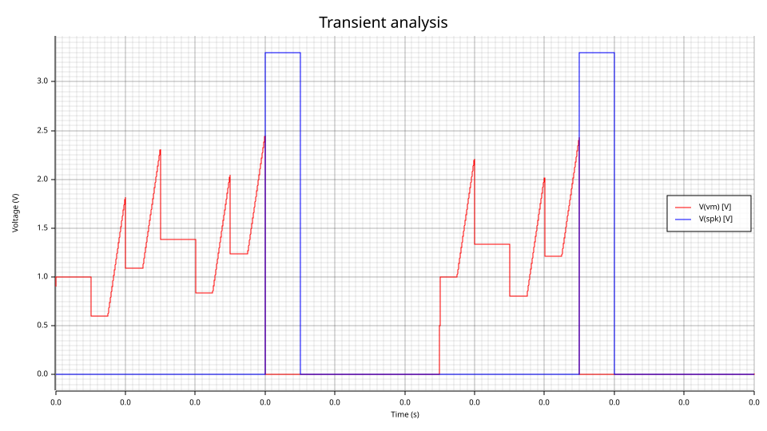
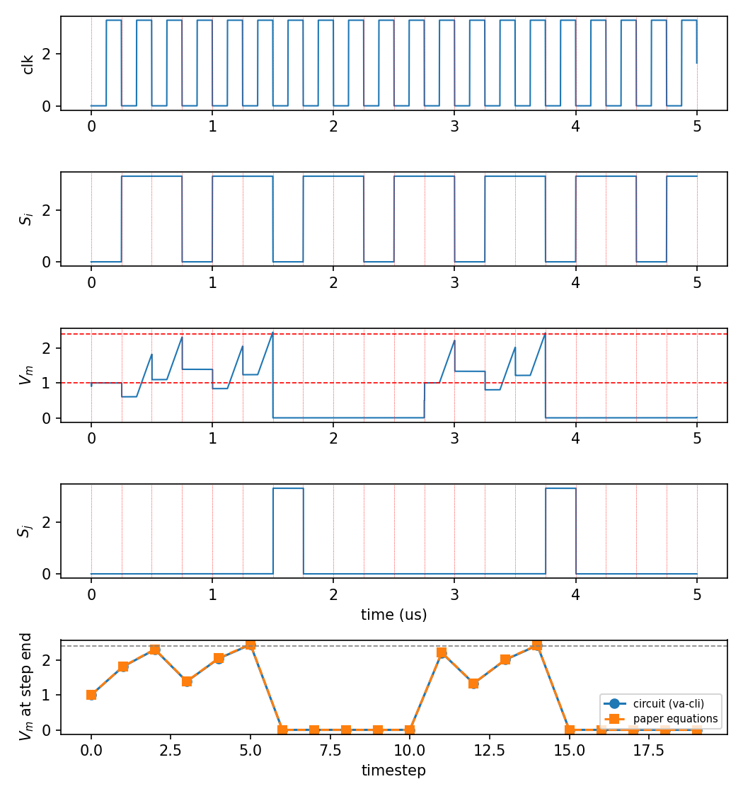
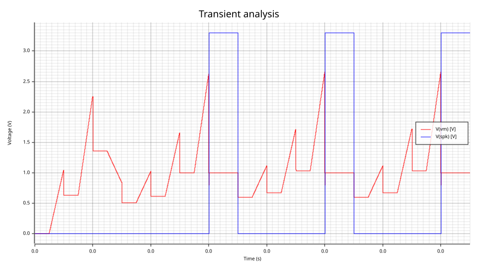
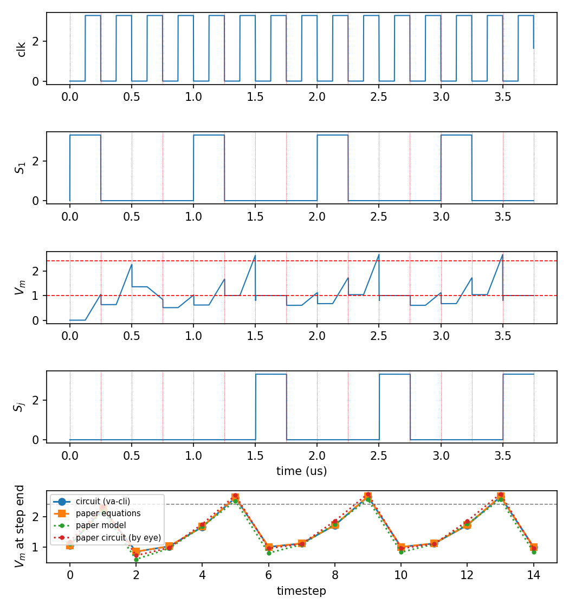

# Memristor-crossbar spiking neuron: review page

**Generated** by `circuits/snn/make_examples.py`; do not edit by hand. It reproduces the
neuron-level results of Xuan et al., IJCNN 2026 (`references/`); the reasoning, the
choices the paper leaves open, and the limitations are in `circuits/snn/README.md`.

Everything below is what was run: the flattened netlists are the decks with their
`.include` files inlined, and each was checked to give byte-identical output to its
source deck. **No transistor models are involved**: the circuit is built at the level of
the paper's functional diagram (its Fig. 3) from the Verilog-A models listed at the end
(RRAM cell, switch, op-amp/attenuator stage, comparator, gating logic) and SPICE
primitives (C, E, V). The paper's IHP SG13S/MEMRES process is not public and it gives no
device sizes.

## Fig. 4: five identical synapses, refractory 1 us



`fig4_vm_spike.svg`: V_m and the output spike from `va-cli --plot`.



`fig4_vs_paper.png`: the clock, input and output in continuous time, then V_m
at each latch edge against the paper's equations (and, for Fig. 5, the paper's own
model and transistor-level values).

Check (PASS; output digest `5a88592efce4ed74`):

```
fig4: V_m at the end of each cycle (V)
  step     circuit   equations
     0       1.000       1.000
     1       1.812       1.820
     2       2.304       2.313
     3       1.388       1.392
     4       2.046       2.056
     5       2.444       2.455
     6       0.000       0.000  spike
     7       0.000       0.000
     8       0.000       0.000
     9       0.000       0.000
    10       0.000       0.000
    11       2.210       2.218
    12       1.332       1.335
    13       2.012       2.021
    14       2.424       2.434
    15       0.000       0.000  spike
    16       0.000       0.000
    17       0.000       0.000
    18       0.000       0.000
    19       0.000       0.000
output spikes, circuit:   steps [6, 15] (t = [1.5, 3.75] us)
output spikes, equations: steps [6, 15]
output spikes, paper:     steps [6, 15]
circuit vs equations: worst |dV| = 0.0108 V (tolerance 0.05 V)
PASS
plot written to fig4_vs_paper.png
```

## Fig. 5: four codebook synapses, circuit vs snnTorch



`fig5_vm_spike.svg`: V_m and the output spike from `va-cli --plot`.



`fig5_vs_paper.png`: the clock, input and output in continuous time, then V_m
at each latch edge against the paper's equations (and, for Fig. 5, the paper's own
model and transistor-level values).

Check (PASS; output digest `a9f631e5f874f8a9`):

```
fig5: V_m at the end of each cycle (V)
  step     circuit   equations  paper model  paper circuit (by eye)
     0       1.044       1.050       1.100       1.170
     1       2.251       2.260       2.170       2.330
     2       0.845       0.846       0.592       0.720
     3       1.020       1.024       0.955       0.970
     4       1.658       1.666       1.673       1.750
     5       2.619       2.631       2.514       2.700
     6       1.000       1.000       0.798       0.950  spike
     7       1.113       1.116       1.079       1.100
     8       1.714       1.722       1.747       1.850
     9       2.653       2.664       2.558       2.750
    10       1.000       1.000       0.825       0.950  spike
    11       1.113       1.116       1.095       1.100
    12       1.714       1.722       1.757       1.850
    13       2.653       2.664       2.564       2.750
    14       1.000       1.000       0.829       0.950  spike
output spikes, circuit:   steps [6, 10, 14] (t = [1.5, 2.5, 3.5] us)
output spikes, equations: steps [6, 10, 14]
output spikes, paper:     steps [6, 10, 14]
circuit vs equations: worst |dV| = 0.0117 V (tolerance 0.05 V)
circuit vs paper model: worst |dV| = 0.253 V
circuit vs paper circuit (by eye): worst |dV| = 0.136 V
PASS
plot written to fig5_vs_paper.png
```

## Synapse codebook (Sec. II-C)

```
levels (mS): [0.125, 0.0952, 0.0667, 0.0048]
G_p - G_n: 13 values [-0.1202, -0.0905, -0.0619, -0.0583, -0.0298, -0.0286, 0.0, 0.0286, 0.0298, 0.0583, 0.0619, 0.0905, 0.1202]
paper:     13 values [-0.1205, -0.0907, -0.0621, -0.0583, -0.0298, -0.0286, 0, 0.0286, 0.0298, 0.0583, 0.0621, 0.0907, 0.1205]
worst difference: 0.0003 mS (tolerance 0.0005 mS)
PASS
```

## Netlist: `fig4_neuron_full.net`

```spice
* GENERATED by circuits/snn/make_examples.py from circuits/snn/fig4_neuron.net
* with every .include inlined. Do not edit; edit the source deck and rerun.
* Run: va-cli sim docs/examples/snn_memristor/fig4_neuron_full.net --model models/snn --tran --report clk,wl,vm,spk
*
* Xuan et al., IJCNN 2026 (references/, hal-05590496), Fig. 4: one analog spiking neuron driven by
* five presynaptic neurons through 2T2R memristor synapses, 20 clock cycles, refractory on.
*
*   va-cli sim circuits/snn/fig4_neuron.net --model models/snn --tran --report clk,wl,vm,spk
*   python circuits/snn/check_snn.py fig4 <that output>
*
* Paper values (Sec. II-D): T = 0.25 us, duty 50 % (dt = 0.125 us); V_th = 2.4 V; beta = 0.6 from
* C_M = 998 fF, C_L = 660 fF; V_reset = 1 V; V_ref = 1.65 V, V_P = 1.75 V, V_N = 1.55 V (V_s = 0.1 V);
* T_ref = 1 us = 4 cycles; every synapse G_p - G_n = 0.0583 mS (8 kOhm and 15 kOhm cells); input
* spike train S_i = 0,1,1,0,1,1,... on all five; V_m initialized to V_reset.
*
* Not in the paper: the attenuator factor K. K = 3 is the value its Fig. 4 implies (the spike times
* 1.50 us and 3.75 us need K in [2.872, 3.047]; circuits/snn/README.md).
*
* Built at the level of the paper's functional diagram (Fig. 3), not its transistors (the IHP
* SG13S/MEMRES process is not public, and the paper gives no sizes): circuits/snn/neuron.inc.

* ===== begin dff.inc (circuits/snn/dff.inc) =====
* A master-slave D flip-flop from two sample-and-hold stages, the structure of a transistor DFF:
* the master capacitor tracks `d` while clk is high and holds it from the falling edge; the slave
* copies the master while qclk is high (the next low phase) and holds it through the high phase.
* So `q` is `d` as it was at the end of a high phase, valid for the whole following cycle, and
* `m` (the master, buffered) is that same value during the following low phase only.
* clk and qclk must not overlap (the decks give them a 1.5-2 ns gap).
*
* `m` exists for glitch-free gating: it changes only on clk edges, while the leak switch (qclk)
* is open. `q` changes inside the qclk window, so gating a reset with `q` near a cycle boundary
* re-resets V_m for the nanosecond the slave takes to update (seen, and fixed, while building this).
*
* Hold time: the master switch opens at clk = 2.5 V on the falling edge, before any gate that
* uses `m` (they act below clk = 1.65 V) can move `d`. At the same threshold (the first build),
* the reset began while the master was still open, so it followed the comparator partway down
* and the spike came out at 2.4-2.6 V instead of 3.3 V. The cost: the comparator's verdict is taken
* ~0.3 ns before the 125 ns integration window closes.
*
* Limitations: ideal buffers (E sources) and switches (models/snn/vswitch.va); the 10 fF sample
* capacitors are there to hold a level, not a sized design.
.subckt dff d q m clk qclk
XSm  d  mc clk  vswitch vt=2.5
Cm   mc gnd 10f IC=0
Em   m  gnd mc gnd 1
XSs  m  s  qclk vswitch
Cs   s  gnd 10f IC=0
Eq   q  gnd s gnd 1
.ends
* ===== end dff.inc =====
* ===== begin neuron.inc (circuits/snn/neuron.inc) =====
* The analog spiking neuron of Xuan et al., IJCNN 2026 (references/, Figs. 2-3), at the level of
* its functional diagram. Included by fig4_neuron.net and fig5_neuron.net, which supply the
* synapses (on `sl`), the bias and clock nets, and `por`.
*
* All state is on capacitors, as in the paper's circuit: the membrane C_M, the leak capacitor
* C_L, and the flip-flops (two sample capacitors each). The Verilog-A parts (models/snn/) are
* memoryless.
*
* Nets used: sl vref vres clk qclk por (in), vm spk (out).

* --- input stage (block A + the clk switch): source line held at V_ref, I_inj = I_in / K into V_m
*     while clk is high. K is set by each deck on its own copy of this line (see the deck header).

* --- membrane and leak (block B): C_L shares charge with C_M in the low phase (qclk) and is
*     emptied in the high phase (clk), so beta = C_M / (C_M + C_L) comes out of the circuit.
CM    vm  gnd 998f IC=0
XSlk  vm  cl  qclk vswitch
CL    cl  gnd 660f IC=0
XSdis cl  gnd clk vswitch

* --- comparator (block C) and D flip-flop (block D): the flip-flop latches the comparator at the
*     end of the high phase; its output, the spike, is high for the whole next cycle (Eq. 6).
Vth   vth gnd DC 2.4
Xcmp  vm vth cmp comparator
Xff0  cmp q0 m0 clk qclk dff
Espk  spk gnd q0 gnd 1
* q0 delayed by 1..4 cycles (the refractory timer), and a fifth master for the end-of-period reset
Xff1  q0 q1 m1 clk qclk dff
Xff2  q1 q2 m2 clk qclk dff
Xff3  q2 q3 m3 clk qclk dff
Xff4  q3 q4 m4 clk qclk dff
Xff5  q4 q5 m5 clk qclk dff

* --- reset (to V_reset) and refractory hold (to 0), Eqs. (7) and (9)
XSrst vm  vres rs vswitch
XShz  vm  gnd  hz vswitch
* ===== end neuron.inc =====

* --- bias
Vvp   vp   gnd  DC 1.75
Vvn   vn   gnd  DC 1.55
Vref  vref gnd  DC 1.65
Vres  vres gnd  DC 1.0
* --- two-phase clock: clk high (integrate) for exactly 125 ns at the end of each 250 ns cycle,
*     qclk high (leak) at its start; non-overlapping by 1.5-2 ns
Vclk  clk  gnd  PULSE(0 3.3 124.5n 1n 1n 124n 250n)
Vqclk qclk gnd  PULSE(0 3.3 2n 1n 1n 119n 250n)
* --- power-on reset: V_m to V_reset in the first low phase
Vpor  por  gnd  PWL(0 3.3 120n 3.3 121n 0)
* --- presynaptic spike train on the word line: S_i = 0,1,1,0,1,1,... (a spike fills its cycle)
Vwl   wl   gnd  PWL(0 0 250n 0 251n 3.3 750n 3.3 751n 0 1000n 0 1001n 3.3 1500n 3.3 1501n 0 1750n 0 1751n 3.3 2250n 3.3 2251n 0 2500n 0 2501n 3.3 3000n 3.3 3001n 0 3250n 0 3251n 3.3 3750n 3.3 3751n 0 4000n 0 4001n 3.3 4500n 3.3 4501n 0 4750n 0 4751n 3.3 5000n 3.3)

* --- five 2T2R synapses: V_P -[G_p]-[access]- SL -[access]-[G_n]- V_N, the access pair on the WL
XGp1 vp p1 rram level=0
XAp1 p1 sl wl vswitch ron=10
XGn1 vn n1 rram level=2
XAn1 n1 sl wl vswitch ron=10
XGp2 vp p2 rram level=0
XAp2 p2 sl wl vswitch ron=10
XGn2 vn n2 rram level=2
XAn2 n2 sl wl vswitch ron=10
XGp3 vp p3 rram level=0
XAp3 p3 sl wl vswitch ron=10
XGn3 vn n3 rram level=2
XAn3 n3 sl wl vswitch ron=10
XGp4 vp p4 rram level=0
XAp4 p4 sl wl vswitch ron=10
XGn4 vn n4 rram level=2
XAn4 n4 sl wl vswitch ron=10
XGp5 vp p5 rram level=0
XAp5 p5 sl wl vswitch ron=10
XGn5 vn n5 rram level=2
XAn5 n5 sl wl vswitch ron=10

* --- the neuron's per-deck settings: K = 3, refractory on
Xin   sl vref vm clk sl_stage k=3
Xlog  q0 q1 q2 q3 q4 m0 m5 clk por rs hz neuron_logic refr=1

* No UIC: the DC operating point, with the power-on reset closed, starts V_m at V_reset.
.tran 0.5n 5u
.end
```

## Netlist: `fig5_neuron_full.net`

```spice
* GENERATED by circuits/snn/make_examples.py from circuits/snn/fig5_neuron.net
* with every .include inlined. Do not edit; edit the source deck and rerun.
* Run: va-cli sim docs/examples/snn_memristor/fig5_neuron_full.net --model models/snn --tran --report clk,wl1,wl2,wl3,wl4,vm,spk
*
* Xuan et al., IJCNN 2026 (references/, hal-05590496), Fig. 5: one neuron driven by four
* presynaptic neurons, 15 timesteps, refractory off, compared with the snnTorch model.
*
*   va-cli sim circuits/snn/fig5_neuron.net --model models/snn --tran --report clk,wl1,vm,spk
*   python circuits/snn/check_snn.py fig5 <that output>
*
* Paper values (Sec. II-D2): T = 0.25 us; model weights {1.10, 1.51, -0.71, 0.60} mapped to the
* codebook values {0.0583, 0.0907, -0.0286, 0.0286} mS; V_th = 2.4 V, beta = 0.6, V_reset = 1 V,
* V_s = 0.1 V as in fig4_neuron.net; refractory disabled (V_bias2 = 0). Input spikes (Fig. 5a):
* S1 at steps 0,4,8,12; S2 at 1,5,9,13; S3 (inhibitory) at 2,6,10,14; S4 at 3,7,11.
*
* Each codebook value as a pair of the four RRAM levels (8, 10.5, 15, 210 kOhm):
*   +0.0583 = 1/8k - 1/15k       +0.0907 = 1/10.5k - 1/210k
*   -0.0286 = 1/15k - 1/10.5k    +0.0286 = 1/10.5k - 1/15k
*
* Not in the paper: K. Eq. (12) maps w to G by w / lambda; the lambda that fits the four weights to
* the four conductances above best (least squares) is 17.99 V/mS, and Eq. (3) turns it into
* K = V_s * dt / (lambda * C_M) = 0.696. The paper's output spikes need K in [0.656, 0.762];
* its Fig. 4 needs K in [2.872, 3.047] (circuits/snn/README.md).
* V_m starts at 0 V (UIC with C_M's IC=0): the paper's step-0 value is the first spike alone.

* ===== begin dff.inc (circuits/snn/dff.inc) =====
* A master-slave D flip-flop from two sample-and-hold stages, the structure of a transistor DFF:
* the master capacitor tracks `d` while clk is high and holds it from the falling edge; the slave
* copies the master while qclk is high (the next low phase) and holds it through the high phase.
* So `q` is `d` as it was at the end of a high phase, valid for the whole following cycle, and
* `m` (the master, buffered) is that same value during the following low phase only.
* clk and qclk must not overlap (the decks give them a 1.5-2 ns gap).
*
* `m` exists for glitch-free gating: it changes only on clk edges, while the leak switch (qclk)
* is open. `q` changes inside the qclk window, so gating a reset with `q` near a cycle boundary
* re-resets V_m for the nanosecond the slave takes to update (seen, and fixed, while building this).
*
* Hold time: the master switch opens at clk = 2.5 V on the falling edge, before any gate that
* uses `m` (they act below clk = 1.65 V) can move `d`. At the same threshold (the first build),
* the reset began while the master was still open, so it followed the comparator partway down
* and the spike came out at 2.4-2.6 V instead of 3.3 V. The cost: the comparator's verdict is taken
* ~0.3 ns before the 125 ns integration window closes.
*
* Limitations: ideal buffers (E sources) and switches (models/snn/vswitch.va); the 10 fF sample
* capacitors are there to hold a level, not a sized design.
.subckt dff d q m clk qclk
XSm  d  mc clk  vswitch vt=2.5
Cm   mc gnd 10f IC=0
Em   m  gnd mc gnd 1
XSs  m  s  qclk vswitch
Cs   s  gnd 10f IC=0
Eq   q  gnd s gnd 1
.ends
* ===== end dff.inc =====
* ===== begin neuron.inc (circuits/snn/neuron.inc) =====
* The analog spiking neuron of Xuan et al., IJCNN 2026 (references/, Figs. 2-3), at the level of
* its functional diagram. Included by fig4_neuron.net and fig5_neuron.net, which supply the
* synapses (on `sl`), the bias and clock nets, and `por`.
*
* All state is on capacitors, as in the paper's circuit: the membrane C_M, the leak capacitor
* C_L, and the flip-flops (two sample capacitors each). The Verilog-A parts (models/snn/) are
* memoryless.
*
* Nets used: sl vref vres clk qclk por (in), vm spk (out).

* --- input stage (block A + the clk switch): source line held at V_ref, I_inj = I_in / K into V_m
*     while clk is high. K is set by each deck on its own copy of this line (see the deck header).

* --- membrane and leak (block B): C_L shares charge with C_M in the low phase (qclk) and is
*     emptied in the high phase (clk), so beta = C_M / (C_M + C_L) comes out of the circuit.
CM    vm  gnd 998f IC=0
XSlk  vm  cl  qclk vswitch
CL    cl  gnd 660f IC=0
XSdis cl  gnd clk vswitch

* --- comparator (block C) and D flip-flop (block D): the flip-flop latches the comparator at the
*     end of the high phase; its output, the spike, is high for the whole next cycle (Eq. 6).
Vth   vth gnd DC 2.4
Xcmp  vm vth cmp comparator
Xff0  cmp q0 m0 clk qclk dff
Espk  spk gnd q0 gnd 1
* q0 delayed by 1..4 cycles (the refractory timer), and a fifth master for the end-of-period reset
Xff1  q0 q1 m1 clk qclk dff
Xff2  q1 q2 m2 clk qclk dff
Xff3  q2 q3 m3 clk qclk dff
Xff4  q3 q4 m4 clk qclk dff
Xff5  q4 q5 m5 clk qclk dff

* --- reset (to V_reset) and refractory hold (to 0), Eqs. (7) and (9)
XSrst vm  vres rs vswitch
XShz  vm  gnd  hz vswitch
* ===== end neuron.inc =====

Vvp   vp   gnd  DC 1.75
Vvn   vn   gnd  DC 1.55
Vref  vref gnd  DC 1.65
Vres  vres gnd  DC 1.0
Vclk  clk  gnd  PULSE(0 3.3 124.5n 1n 1n 124n 250n)
Vqclk qclk gnd  PULSE(0 3.3 2n 1n 1n 119n 250n)
Vpor  por  gnd  DC 0
* one word line per presynaptic neuron; a spike fills its 250 ns cycle
Vwl1  wl1  gnd  PULSE(0 3.3 0 1n 1n 249n 1000n)
Vwl2  wl2  gnd  PULSE(0 3.3 250n 1n 1n 249n 1000n)
Vwl3  wl3  gnd  PULSE(0 3.3 500n 1n 1n 249n 1000n)
Vwl4  wl4  gnd  PWL(0 0 750n 0 751n 3.3 1000n 3.3 1001n 0 1750n 0 1751n 3.3 2000n 3.3 2001n 0 2750n 0 2751n 3.3 3000n 3.3 3001n 0 3750n 0)

* S1: +0.0583 mS
XGp1 vp p1 rram level=0
XAp1 p1 sl wl1 vswitch ron=10
XGn1 vn n1 rram level=2
XAn1 n1 sl wl1 vswitch ron=10
* S2: +0.0907 mS
XGp2 vp p2 rram level=1
XAp2 p2 sl wl2 vswitch ron=10
XGn2 vn n2 rram level=3
XAn2 n2 sl wl2 vswitch ron=10
* S3: -0.0286 mS
XGp3 vp p3 rram level=2
XAp3 p3 sl wl3 vswitch ron=10
XGn3 vn n3 rram level=1
XAn3 n3 sl wl3 vswitch ron=10
* S4: +0.0286 mS
XGp4 vp p4 rram level=1
XAp4 p4 sl wl4 vswitch ron=10
XGn4 vn n4 rram level=2
XAn4 n4 sl wl4 vswitch ron=10

* --- the neuron's per-deck settings: K = 0.696, refractory off
Xin   sl vref vm clk sl_stage k=0.696
Xlog  q0 q1 q2 q3 q4 m0 m5 clk por rs hz neuron_logic refr=0

.tran 0.5n 3.75u UIC
.end
```

## Verilog-A models (`models/snn/`)

### `comparator.va`

```verilog
// Comparator of the analog spiking neuron in Xuan et al., IJCNN 2026 (references/, Fig. 2 block C):
// V(out) goes to `vdd` when V(inp) > V(inn), to 0 otherwise, through a logistic (written with tanh,
// which saturates where exp would overflow) of width `vw` so Newton sees a continuous derivative.
//
// Limitations: memoryless, so it has no hysteresis. The paper uses a tunable Schmitt trigger, but
// its output is only read at the flip-flop's latch edge, where V_m is settled. It has no delay and
// no offset. The threshold is the voltage on `inn`, not the paper's V_bias1.
`include "../disciplines.vams"

module comparator(inp, inn, out);
    input inp, inn;
    output out;
    electrical inp, inn, out;
    parameter real vdd = 3.3 from (0:inf);
    parameter real vw = 0.002 from (0:inf);
    analog V(out) <+ 0.5 * vdd * (1.0 + tanh(0.5 * (V(inp) - V(inn)) / vw));
endmodule
```

### `neuron_logic.va`

```verilog
// Reset and refractory gating of the analog spiking neuron in Xuan et al., IJCNN 2026 (references/,
// Fig. 3: the OR gate driving rs_act, the refractory hold, End_RePe). Memoryless: every bit of
// state lives in the flip-flops of the deck (circuits/snn/dff.inc), as in the paper's circuit,
// where it lives on capacitors.
//
// Inputs are logic voltages (0 / vdd). From the flip-flop chain: `q0` is the spike, high for the
// whole cycle after V_m crossed V_th; `q1`..`q4` are q0 delayed by 1..4 cycles; `m0` is high in the
// low phase of the spike cycle, `m5` in the low phase 5 cycles later (both are master latches: they
// hold from the falling clk edge, but are transparent while clk is high, so they are used gated by
// clk low -- ungated, the hold switch closes a loop through the comparator and V_m settles at V_th,
// which is what the first build did). `por` is a power-on reset request.
//   refr = 0 (refractory disabled): rs = por OR (m0 AND clk low) OR (q0 AND clk)
//            -- V_m held at V_reset for the whole spike cycle, released at its last clk edge,
//            before the next leak phase.
//   refr = 1 (T_ref = 4 cycles): hz = (m0 AND clk low) OR q0 .. q4
//            -- V_m held at 0 for the spike cycle and the 4 refractory cycles;
//            rs = por OR (m5 AND clk low)
//            -- V_m restarts from V_reset in the low phase after them (End_RePe).
//
// Limitations: T_ref is fixed at 4 cycles by the deck's flip-flop chain, where the paper sets it
// continuously with V_bias2 through an analog countdown. The outputs are smooth "gates" (tanh), not
// transistors.
`include "../disciplines.vams"

module neuron_logic(q0, q1, q2, q3, q4, m0, m5, clk, por, rs, hz);
    input q0, q1, q2, q3, q4, m0, m5, clk, por;
    output rs, hz;
    electrical q0, q1, q2, q3, q4, m0, m5, clk, por, rs, hz;
    parameter integer refr = 0 from [0:1];
    parameter real vdd = 3.3 from (0:inf);
    parameter real vw = 0.05 from (0:inf);
    real a, b, lo;
    analog begin
        // a master latch is transparent while clk is high, so it may only gate while clk is low
        lo = 1.0 - V(clk) / vdd;
        if (refr == 1) begin
            a = V(por) + V(m5) * lo;
            b = V(m0) * lo + V(q0) + V(q1) + V(q2) + V(q3) + V(q4);
        end else begin
            a = V(por) + V(m0) * lo + V(q0) * (1.0 - lo);
            b = 0.0;
        end
        V(rs) <+ 0.5 * vdd * (1.0 + tanh(0.5 * (a - vdd / 2) / vw));
        V(hz) <+ 0.5 * vdd * (1.0 + tanh(0.5 * (b - vdd / 2) / vw));
    end
endmodule
```

### `rram.va`

```verilog
// A programmed RRAM cell of IHP's SG13S MEMRES module (TiN/HfO2-x/TiN), as used for inference
// in Xuan et al., "Automated Model-to-Transistor Design Framework for Memristor Crossbar-Based
// Spiking Neural Network Architectures", IJCNN 2026 (references/, hal-05590496), Sec. II-C.
//
// The cell is programmed once (ISPVA) to one of four stable levels, from the paper's
// characterization data: 8 kOhm (LRS1), 10.5 kOhm (LRS2), 15 kOhm (LRS3), 210 kOhm (HRS).
// `level` selects one: 0 = LRS1 ... 3 = HRS; `level = -1` uses `r` directly.
//
// Limitations: during inference the cell is read at Vs = 0.1 V, below the read-disturb limit the
// paper keeps it under (0.5 V), so the model is a fixed, linear conductance. It has no switching
// dynamics, no drift, no read disturb, no variability, and no I-V nonlinearity. It is not a
// model for programming the cell.
`include "../disciplines.vams"

module rram(p, n);
    inout p, n;
    electrical p, n;
    parameter integer level = 0 from [-1:3];
    parameter real r = 8e3 from (0:inf);
    real rcell;
    analog begin
        case (level)
            0: rcell = 8e3;
            1: rcell = 10.5e3;
            2: rcell = 15e3;
            3: rcell = 210e3;
            default: rcell = r;
        endcase
        I(p, n) <+ V(p, n) / rcell;
    end
endmodule
```

### `sl_stage.va`

```verilog
// Input stage of the analog spiking neuron in Xuan et al., IJCNN 2026 (references/, Fig. 2 block A,
// Fig. 3): the op-amp holds the source line at V_ref, the attenuator scales the collected synaptic
// current by 1/K, and the clk switch lets it into the membrane only in the high (integration)
// phase.
//
// `sl` is the source line and `vr` the V_ref node; the branch between them is a 0 V source, so its
// current I(sense) is I_in, the sum of every active synapse's (G_p - G_n) * V_s. The node `out`
// receives I_inj = I_in / K while V(clk) is high.
//
// Limitations: ideal. The op-amp has infinite gain and bandwidth and no offset, the attenuator is
// exactly linear, and the clk gate is a logistic (written with tanh, which saturates where exp
// would overflow) in V(clk) (width `vw`), not a transistor, so it has no charge injection. Outside
// the high phase the current is simply not delivered; in the paper's circuit it flows elsewhere
// (Fig. 2), with no effect on V_m either way.
`include "../disciplines.vams"

module sl_stage(sl, vr, out, clk);
    inout sl, vr, out;
    input clk;
    electrical sl, vr, out, clk;
    parameter real k = 1.0 from (0:inf);
    parameter real vdd = 3.3 from (0:inf);
    parameter real vw = 0.05 from (0:inf);
    branch (sl, vr) sense;
    analog begin
        V(sense) <+ 0.0;
        I(out) <+ -I(sense) / k * 0.5 * (1.0 + tanh(0.5 * (V(clk) - vdd / 2) / vw));
    end
endmodule
```

### `vswitch.va`

```verilog
// A voltage-controlled switch: the access transistors of the 2T2R synapse and the clocked switches
// of the spiking neuron in Xuan et al., IJCNN 2026 (references/, Figs. 2-3).
//
// The conductance moves smoothly (a logistic (written with tanh, which saturates where exp would
// overflow) in the control voltage) from 1/roff to 1/ron around `vt`, over a width `vw`, so Newton
// sees a continuous derivative. `pol = -1` closes the switch when the control is LOW, which gives a
// complementary pair from one clock, so a current steered between two switches never finds both
// open.
//
// Limitations: a switch, not a transistor. There is no charge injection, no clock feedthrough, no
// body effect, and `ron` does not depend on the terminal voltages. The paper's transistor-level
// circuit has all of these, which is part of why its traces differ slightly from its model.
`include "../disciplines.vams"

module vswitch(p, n, c);
    inout p, n;
    input c;
    electrical p, n, c;
    parameter real ron = 50 from (0:inf);
    parameter real roff = 1e12 from (0:inf);
    parameter real vt = 1.65;
    parameter real vw = 0.05 from (0:inf);
    parameter integer pol = 1 from [-1:1] exclude 0;
    real g;
    analog begin
        g = 1.0 / roff
            + (1.0 / ron - 1.0 / roff) * 0.5 * (1.0 + tanh(0.5 * pol * (V(c) - vt) / vw));
        I(p, n) <+ g * V(p, n);
    end
endmodule
```
