# Multiphysics examples

One solution vector, many physical domains. Each example below couples two or more disciplines
— electrical, thermal, mechanical, magnetic, optical, chemical, acoustic, fluidic — through
Verilog-A models written for it, and each is chosen to exercise a different part of the
language and of the simulator. They live in `models/multiphysics/<example>/` (the models, and
the `nature`/`discipline` declarations they need) and `circuits/multiphysics/` (the decks), and
every deck's header says what the run should show and the closed-form numbers to check it
against.

**What these are, and are not.** Demonstrations, checked against closed-form results and
conservation laws where one exists (each says which). They are not validated against a
reference simulator the way the decks under `golden/` are: QSPICE cannot run these models, and
nothing here claims a tolerance it has not measured.

Every command is reproducible as written from the repository root.

## Verilog-A coverage

Which language features each example uses, so the set as a whole reads as a coverage map.

| Construct | Examples |
|---|---|
| user `nature` / `discipline` declarations | [TEC](#peltier-cooler-under-pid-control), [MEMS](#electrostatic-mems-pull-in-damping-contact-and-stiction), [ReRAM](#filamentary-reram-filament-growth-joule-heating-arrhenius-drift), [HH axon](#hodgkinhuxley-axon-propagation-temperature-and-sodium-accumulation), [power grid](#power-grid-swing-equal-areas-relays-and-a-cascade), [ring bank](#thermo-optic-ring-bank-self-heating-crosstalk-and-locking), [Li-ion](#li-ion-cell-kinetics-diffusion-aging-and-thermal-runaway), [relay](#electromagnetic-relay-jilesatherton-hysteresis-eddy-currents-heating-and-contact-bounce), [Gray-Scott](#grayscott-reactiondiffusion-a-pattern-forming-grid) |
| several disciplines in one module | [TEC](#peltier-cooler-under-pid-control), [MEMS](#electrostatic-mems-pull-in-damping-contact-and-stiction), [ReRAM](#filamentary-reram-filament-growth-joule-heating-arrhenius-drift), [HH axon](#hodgkinhuxley-axon-propagation-temperature-and-sodium-accumulation), [power grid](#power-grid-swing-equal-areas-relays-and-a-cascade), [ring bank](#thermo-optic-ring-bank-self-heating-crosstalk-and-locking), [Li-ion](#li-ion-cell-kinetics-diffusion-aging-and-thermal-runaway), [relay](#electromagnetic-relay-jilesatherton-hysteresis-eddy-currents-heating-and-contact-bounce) |
| `analog function` | [TEC](#peltier-cooler-under-pid-control), [MEMS](#electrostatic-mems-pull-in-damping-contact-and-stiction), [ReRAM](#filamentary-reram-filament-growth-joule-heating-arrhenius-drift), [HH axon](#hodgkinhuxley-axon-propagation-temperature-and-sodium-accumulation), [Li-ion](#li-ion-cell-kinetics-diffusion-aging-and-thermal-runaway), [relay](#electromagnetic-relay-jilesatherton-hysteresis-eddy-currents-heating-and-contact-bounce) |
| ranged parameters (`from`, `exclude`) | [TEC](#peltier-cooler-under-pid-control), [MEMS](#electrostatic-mems-pull-in-damping-contact-and-stiction), [ReRAM](#filamentary-reram-filament-growth-joule-heating-arrhenius-drift), [HH axon](#hodgkinhuxley-axon-propagation-temperature-and-sodium-accumulation), [power grid](#power-grid-swing-equal-areas-relays-and-a-cascade), [ring bank](#thermo-optic-ring-bank-self-heating-crosstalk-and-locking), [Li-ion](#li-ion-cell-kinetics-diffusion-aging-and-thermal-runaway), [relay](#electromagnetic-relay-jilesatherton-hysteresis-eddy-currents-heating-and-contact-bounce), [Gray-Scott](#grayscott-reactiondiffusion-a-pattern-forming-grid) |
| `ddt` | [TEC](#peltier-cooler-under-pid-control), [MEMS](#electrostatic-mems-pull-in-damping-contact-and-stiction), [ReRAM](#filamentary-reram-filament-growth-joule-heating-arrhenius-drift), [HH axon](#hodgkinhuxley-axon-propagation-temperature-and-sodium-accumulation), [power grid](#power-grid-swing-equal-areas-relays-and-a-cascade), [ring bank](#thermo-optic-ring-bank-self-heating-crosstalk-and-locking), [Li-ion](#li-ion-cell-kinetics-diffusion-aging-and-thermal-runaway), [relay](#electromagnetic-relay-jilesatherton-hysteresis-eddy-currents-heating-and-contact-bounce), [Gray-Scott](#grayscott-reactiondiffusion-a-pattern-forming-grid) |
| `laplace_nd` | [TEC](#peltier-cooler-under-pid-control) |
| `transition` | [TEC](#peltier-cooler-under-pid-control), [power grid](#power-grid-swing-equal-areas-relays-and-a-cascade), [ring bank](#thermo-optic-ring-bank-self-heating-crosstalk-and-locking), [Li-ion](#li-ion-cell-kinetics-diffusion-aging-and-thermal-runaway) |
| internal nodes as state variables | [TEC](#peltier-cooler-under-pid-control), [MEMS](#electrostatic-mems-pull-in-damping-contact-and-stiction), [ReRAM](#filamentary-reram-filament-growth-joule-heating-arrhenius-drift), [HH axon](#hodgkinhuxley-axon-propagation-temperature-and-sodium-accumulation), [power grid](#power-grid-swing-equal-areas-relays-and-a-cascade), [ring bank](#thermo-optic-ring-bank-self-heating-crosstalk-and-locking), [Li-ion](#li-ion-cell-kinetics-diffusion-aging-and-thermal-runaway), [relay](#electromagnetic-relay-jilesatherton-hysteresis-eddy-currents-heating-and-contact-bounce) |
| `@(timer)` | [TEC](#peltier-cooler-under-pid-control), [power grid](#power-grid-swing-equal-areas-relays-and-a-cascade), [ring bank](#thermo-optic-ring-bank-self-heating-crosstalk-and-locking), [Li-ion](#li-ion-cell-kinetics-diffusion-aging-and-thermal-runaway), [Gray-Scott](#grayscott-reactiondiffusion-a-pattern-forming-grid) |
| `@(cross)` with a direction | [TEC](#peltier-cooler-under-pid-control), [MEMS](#electrostatic-mems-pull-in-damping-contact-and-stiction), [ReRAM](#filamentary-reram-filament-growth-joule-heating-arrhenius-drift), [HH axon](#hodgkinhuxley-axon-propagation-temperature-and-sodium-accumulation), [power grid](#power-grid-swing-equal-areas-relays-and-a-cascade), [ring bank](#thermo-optic-ring-bank-self-heating-crosstalk-and-locking), [Li-ion](#li-ion-cell-kinetics-diffusion-aging-and-thermal-runaway), [relay](#electromagnetic-relay-jilesatherton-hysteresis-eddy-currents-heating-and-contact-bounce) |
| `$strobe`, `%m` | [TEC](#peltier-cooler-under-pid-control), [MEMS](#electrostatic-mems-pull-in-damping-contact-and-stiction), [ReRAM](#filamentary-reram-filament-growth-joule-heating-arrhenius-drift), [HH axon](#hodgkinhuxley-axon-propagation-temperature-and-sodium-accumulation), [power grid](#power-grid-swing-equal-areas-relays-and-a-cascade), [ring bank](#thermo-optic-ring-bank-self-heating-crosstalk-and-locking), [Li-ion](#li-ion-cell-kinetics-diffusion-aging-and-thermal-runaway), [relay](#electromagnetic-relay-jilesatherton-hysteresis-eddy-currents-heating-and-contact-bounce), [Gray-Scott](#grayscott-reactiondiffusion-a-pattern-forming-grid) |
| `.op`, `.dc` sweep, `.tran` | [TEC](#peltier-cooler-under-pid-control), [MEMS](#electrostatic-mems-pull-in-damping-contact-and-stiction) |
| `ddt` of a nonlinear charge (`d/dt[C(x)V]`) | [MEMS](#electrostatic-mems-pull-in-damping-contact-and-stiction) |
| a coefficient times `ddt` | [MEMS](#electrostatic-mems-pull-in-damping-contact-and-stiction), [relay](#electromagnetic-relay-jilesatherton-hysteresis-eddy-currents-heating-and-contact-bounce) |
| event variables persisting across events (bounce counter) | [MEMS](#electrostatic-mems-pull-in-damping-contact-and-stiction), [power grid](#power-grid-swing-equal-areas-relays-and-a-cascade), [ring bank](#thermo-optic-ring-bank-self-heating-crosstalk-and-locking), [Li-ion](#li-ion-cell-kinetics-diffusion-aging-and-thermal-runaway), [relay](#electromagnetic-relay-jilesatherton-hysteresis-eddy-currents-heating-and-contact-bounce) |
| `.ac` small-signal analysis | [MEMS](#electrostatic-mems-pull-in-damping-contact-and-stiction) |
| `@(above)` | [ReRAM](#filamentary-reram-filament-growth-joule-heating-arrhenius-drift) |
| `analysis("static")` (DC-only initial condition of a state) | [ReRAM](#filamentary-reram-filament-growth-joule-heating-arrhenius-drift), [HH axon](#hodgkinhuxley-axon-propagation-temperature-and-sodium-accumulation), [Li-ion](#li-ion-cell-kinetics-diffusion-aging-and-thermal-runaway), [relay](#electromagnetic-relay-jilesatherton-hysteresis-eddy-currents-heating-and-contact-bounce), [Gray-Scott](#grayscott-reactiondiffusion-a-pattern-forming-grid) |
| `$bound_step` | [ReRAM](#filamentary-reram-filament-growth-joule-heating-arrhenius-drift) |
| `SIN` / `PWL` sources driving a model | [ReRAM](#filamentary-reram-filament-growth-joule-heating-arrhenius-drift), [ring bank](#thermo-optic-ring-bank-self-heating-crosstalk-and-locking) |
| `generate` loops over a `genvar`, vector nets of user disciplines | [HH axon](#hodgkinhuxley-axon-propagation-temperature-and-sodium-accumulation), [Li-ion](#li-ion-cell-kinetics-diffusion-aging-and-thermal-runaway), [Gray-Scott](#grayscott-reactiondiffusion-a-pattern-forming-grid) |
| integer parameters sizing structure, overridden per instance | [HH axon](#hodgkinhuxley-axon-propagation-temperature-and-sodium-accumulation), [Gray-Scott](#grayscott-reactiondiffusion-a-pattern-forming-grid) |
| `PULSE` sources, a VCCS current drive | [HH axon](#hodgkinhuxley-axon-propagation-temperature-and-sodium-accumulation), [relay](#electromagnetic-relay-jilesatherton-hysteresis-eddy-currents-heating-and-contact-bounce) |
| a DC operating point that is a nonlinear network solve (load flow) | [power grid](#power-grid-swing-equal-areas-relays-and-a-cascade) |
| protection as events: a relay latching a line open | [power grid](#power-grid-swing-equal-areas-relays-and-a-cascade) |
| a complex ODE as two real state nodes (coupled-mode theory) | [ring bank](#thermo-optic-ring-bank-self-heating-crosstalk-and-locking) |
| one-way signal ports written as potentials (optical power, wavelength) | [ring bank](#thermo-optic-ring-bank-self-heating-crosstalk-and-locking) |
| a stiff system: ps optics against ms thermals | [ring bank](#thermo-optic-ring-bank-self-heating-crosstalk-and-locking) |
| `case` on an integer parameter; a potential contribution that reads its own branch current (inverted Butler-Volmer) | [Li-ion](#li-ion-cell-kinetics-diffusion-aging-and-thermal-runaway) |
| a run from hours-long smouldering to seconds-long runaway (step control across 4 decades) | [Li-ion](#li-ion-cell-kinetics-diffusion-aging-and-thermal-runaway) |
| a hysteretic ODE with direction-dependent right-hand side (Jiles-Atherton) | [relay](#electromagnetic-relay-jilesatherton-hysteresis-eddy-currents-heating-and-contact-bounce) |
| position-dependent coupling between magnetic and mechanical domains | [relay](#electromagnetic-relay-jilesatherton-hysteresis-eddy-currents-heating-and-contact-bounce) |
| two-dimensional vector nets, nested `generate` loops | [Gray-Scott](#grayscott-reactiondiffusion-a-pattern-forming-grid) |
| an event `or` list (`initial_step or timer(...) or final_step`) | [Gray-Scott](#grayscott-reactiondiffusion-a-pattern-forming-grid) |
| file output from a model (`$fopen`/`$fwrite`/`$fdisplay`/`$fclose`) | [Gray-Scott](#grayscott-reactiondiffusion-a-pattern-forming-grid) |

---

## Peltier cooler under PID control

**Domains:** electrical, thermal (absolute temperature). **Models:**
`models/multiphysics/tec/` — `tec.va` (the module), `thermal_parts.va` (heat capacity,
thermal resistance, ambient, stepped heat load), `pid.va` (controller), `tec_natures.vams`
(the `thermal_abs` discipline: kelvin above 0 K, watts).

The thermoelectric module carries all four thermoelectric effects. The Seebeck coefficient
depends on temperature, α(T) = α₀ + α₁(T − 300 K), and from that one assumption everything
else follows consistently:

- the Seebeck EMF is ∫α dT between the faces, so the electrical side sees I = (V − ∫α dT)/R;
- each junction pumps Peltier heat Π·I with Π = α(T)·T at its own temperature;
- Joule heat I²R returns half to each face, conduction K·ΔT leaks back;
- the **Thomson** heat I·∫T dα/dT dT is what is left over, absorbed in the legs.

That last term is not an extra assumption but the bookkeeping that makes the energy balance
close: heat out of the hot face equals heat pumped from the cold face plus electrical power,
exactly. The controller is a PID with a filtered derivative and back-calculation anti-windup,
closing at `ton` through `@(timer)` and ramping in with `transition`.

### 1. Maximum temperature difference — DC sweep against the closed form

```bash
va-cli sim circuits/multiphysics/tec_dtmax.net --model models/multiphysics/tec --report cold --plot docs/examples/multiphysics/tec_dtmax.svg
```


Constant α and R, hot face at 300 K, cold face insulated, drive swept 0–20 V. The cold face is
coldest where the extra heat pumped by more current equals the extra Joule heat it brings,
I = α·T_c/R, and the closed form gives **T_c = 232.455 K (ΔT = 67.545 K) at 5.811 A, 15.00 V**.
The sweep's minimum is **232.4555 K at 15.00 V, 5.8114 A**. Past it the cold face warms again.

### 2. Energy audit — operating point

```bash
va-cli sim circuits/multiphysics/tec_energy.net --model models/multiphysics/tec
```

The full model (Thomson effect and 0.4 %/K resistance tempco on) at 5 V between two thermal
resistances to ambient: Q_c = 10.2223 W pumped, P_e = 9.7547 W electrical, Q_h = 19.9769 W
rejected, **Q_h − Q_c − P_e = −2.5·10⁻⁶ W**, the print precision. The Thomson heat in this
balance is 1.44 W; drop it from the model and the books are off by that much.

### 3. Closed-loop regulation through a load step — transient

```bash
va-cli sim circuits/multiphysics/tec_pid.net --model models/multiphysics/tec --tran --report plate,sink --plot docs/examples/multiphysics/tec_pid_temps.svg
va-cli sim circuits/multiphysics/tec_pid.net --model models/multiphysics/tec --tran --report drv --plot docs/examples/multiphysics/tec_pid_drive.svg
```


A 20 J/K plate under a 1 W load, held at 278.15 K (5 °C) by the PID; the module's hot face
on a 50 J/K sink, 0.5 K/W to a 298.15 K ambient. The run starts from the uncooled steady state
(plate 299.79 K). What it shows:

1. The loop closes at 5 s and the drive saturates at the 12 V rail for a second; the plate
   falls 21.6 K and enters the 0.1 K band at **t = 30.86 s**, reported by the model's
   `@(cross)`, without undershooting the setpoint: the back-calculation term bled the
   integrator while the output was clamped.
2. The sink warms to 311.7 K under the pumped heat plus the electrical power, then relaxes as
   the drive falls to ~3.4 V; the temperature difference the module must hold changes with it.
3. At 60 s the load steps to 3 W (`@(timer)` + `transition`, reported by `$strobe`); the plate
   rises by 0.18 K, the drive rises to answer it, and the integrator brings the plate back
   toward 278.15 K (278.147 K at 150 s, still closing).

**Limitations.** Lumped faces (no temperature profile in the legs; the Thomson heat is split
half and half), temperature-independent K, an ideal voltage-driven supply.

---

## Electrostatic MEMS: pull-in, damping, contact and stiction

**Domains:** electrical, mechanical (position-as-potential: force is the flow, so a node's
Kirchhoff sum is Newton's law), thermal (a thermoelastic mode). **Models:**
`models/multiphysics/mems/mems_parts.va` — composable parts on one mechanical node: `proof_mass`
(inertia, velocity as an internal node), `spring`, `es_gap` (parallel-plate transducer over a
dielectric layer: charge `d/dt[C(x) V]` and force εAV²/2g²), `squeeze_film` (gap-cubed gas
damping with rarefaction), `thermoelastic`, `contact` (Hertzian landing plus adhesion) —
and `mems_natures.vams`.

A 100 µm square plate, 2 µm over an electrode covered by 0.1 µm of dielectric, on a 1 N/m
spring (10 kHz). Thermoelastic damping is not a fitted Q: the plate is coupled to a thermal mode
(force −γθ on the plate, heat γT₀ẋ into the mode, relaxing with τ = 15.9 µs), and Zener's
frequency-dependent damping comes out of the circuit.

### 1. Pull-in — DC sweep against the closed form

```bash
va-cli sim circuits/multiphysics/mems_pullin.net --model models/multiphysics/mems --report x --plot docs/examples/multiphysics/mems_pullin.svg
```


The static balance kx = εAV²/2(g_e − x)² (g_e = 2.0133 µm, the dielectric included) has a
stable branch only up to **V_PI = √(8k g_e³/27εA) = 5.2259 V** at x = g_e/3. The sweep matches the
closed form at every point checked — 0.045741, 0.220332, 0.456840 µm at 2, 4, 5 V, to the
printed digits — and jumps onto the dielectric stop between 5.20 and 5.25 V.

### 2. Resonance under bias, at two pressures — AC

```bash
va-cli sim circuits/multiphysics/mems_resonance.net --model models/multiphysics/mems --ac --report xlo,xhi --plot docs/examples/multiphysics/mems_resonance.svg
```


Biased at 3 V, the electrostatic spring softens the plate by εAV²/g³ = 0.1156 N/m, and the
thermoelastic coupling stiffens it by γ²T₀R·ω²τ/(1+ω²τ²) = 4.7·10⁻⁴ N/m: the resonance moves from
10006 Hz to **9412.55 Hz**, which is where both packages peak. The damping differs: at 1 Pa the
rarefied gas barely damps (Q_squeeze ≈ 17000) and thermoelastic loss limits **Q to 1605**; at
100 Pa the squeeze film dominates, **Q = 78.2**. Both match the models' equations (1605.2 and
78.2 measured).

This check found a sign error in the first draft of `thermoelastic`: with the compression heat
entered as a sink rather than a source, the coupling pumped energy into the motion, and Q came
out 1973 instead of 1605 — exactly what negative thermoelastic damping predicts.

### 3. Pull-in, bounce, stiction and release — transient

```bash
va-cli sim circuits/multiphysics/mems_hysteresis.net --model models/multiphysics/mems --tran --report x --plot docs/examples/multiphysics/mems_hysteresis.svg
```


A slow 0 → 7 → 0 V triangle at 100 Pa. The plate lands at 5.38 V (V_PI plus the ~0.1 ms snap),
**bounces 48 times** on the Hertzian contact while it rings down, sticks, and releases only at
**0.7038 V** — against the closed form √(2g_c²(kx_c − f_a)/εA) = 0.7023 V. In contact the gap
is the 0.1 µm dielectric, so the same voltage pulls ~316 times harder, and the 0.2 µN adhesion
moves release from 0.742 V down to 0.702 V. The `contact` model's events report the landing,
count the bounces, and report the release.

**Limitations.** One rigid plate (no plate bending, no fringing fields), the squeeze film at low
squeeze number (no gas spring), a lumped single-mode thermoelastic coupling, an ideal voltage
drive.

---

## Filamentary ReRAM: filament growth, Joule heating, Arrhenius drift

**Domains:** electrical, thermal (the filament's temperature rise), and the filament itself — a
user `gap_disc` discipline whose potential is the gap in nanometres. **Models:**
`models/multiphysics/reram/reram.va`, `reram_natures.vams`.

The cell's state is the gap g between the filament tip and the electrode (a Stanford–PKU-type
model): the current tunnels across it, I = i₀·e^(−g/g₀)·sinh(V/v₀), and the gap moves by
thermally activated, field-driven ion drift,
dg/dt = −ν₀·e^(−Eₐ/kT)·sinh(γa₀V/(t_ox·kT)), with T the filament's own temperature: ambient
plus the rise its Joule heat V·I drives through a 1 MK/W thermal resistance. The gap is a state
node pinned to its initial value at the DC point (`analysis("static")`), the switching events
are reported by `@(above)` and `@(cross)`, and a fast-moving gap asks for short steps through
`$bound_step`.

### 1. SET, RESET and temperature — triangular sweep at two ambients

```bash
va-cli sim circuits/multiphysics/reram_sweep.net --model models/multiphysics/reram --tran --report X1.g,X2.g --plot docs/examples/multiphysics/reram_gap.svg
va-cli sim circuits/multiphysics/reram_sweep.net --model models/multiphysics/reram --tran --report X1.th,X2.th --plot docs/examples/multiphysics/reram_temp.svg
python docs/examples/multiphysics/reram_iv.py target/release/va-cli
```


Two cells behind 2 kΩ, swept 0 → +1.6 → −1.6 → 0 V in 10 ms, one at 300 K and one at 400 K.

- **SET is self-limiting.** The gap starts closing at 0.641 V (filament at 413 K) but the
  series resistor takes a growing share of the voltage as the cell conducts — the current
  compliance — and the gap closes from 1.5 to 0.3 nm over 0.58 ms of the ramp.
- **RESET is abrupt and thermal.** It waits until the low-resistance cell carries enough current
  to heat its filament to ~610 K (at −0.830 V), and then the opening cell takes the voltage back
  from the resistor: the gap reopens from 0.3 to 1.5 nm in **10.5 µs**, 1/700 of the ramp.
- **Arrhenius.** The 400 K cell switches at 0.507 V / −0.696 V: e^(−Eₐ/kT) is 1,412 times
  larger at its starting temperature (Eₐ = 0.75 eV).
- **The loop is pinched**: I = 0 whenever V = 0, whatever the state.

A model with the field-enhancement factor twice as large (γ = 16) switched in under a
picosecond at the end of RESET, and no time step could follow it; the value used here (γ = 8)
keeps the physics and the time scales resolvable. Both events carry a 1 ns time tolerance
(`cross(expr, +1, 1e-9)`), so what they print is the state *at* the crossing. With it, the SET
and RESET voltages agree to 0.1 mV between 1 µs and 0.2 µs maximum steps. Without it they
belonged to whichever accepted point first fell past mid-gap, and RESET's moved by 22 mV with
the step.

### 2. The frequency fingerprint — the loop shrinks as the drive outruns the drift

```bash
python docs/examples/multiphysics/reram_loops.py target/release/va-cli
```


The same cell on ±1.6 V sinusoids (decks `reram_freq_5k`, `_500k`, `_5meg`, two periods each;
the second is kept). A memristor's defining signature (Chua) is a pinched loop whose lobes
shrink as the frequency grows, because the state cannot follow a fast drive. Measured, with the
two lobes integrated separately (they are traversed in opposite directions, so one signed
∮I dV would cancel them):

| Drive | Gap range over a cycle | Lobe areas (V·A) |
|---|---|---|
| 5 kHz | 0.238 – 1.697 nm | 3.19·10⁻⁴ + 3.20·10⁻⁴ |
| 500 kHz | 0.759 – 1.687 nm | 2.19·10⁻⁴ + 2.18·10⁻⁴ |
| 5 MHz | 1.326 – 1.688 nm | 5.8·10⁻⁵ + 5.8·10⁻⁵ |

Below ~5 kHz the cell still switches completely every cycle (at 50 Hz and 500 Hz the gap spans
the full 0.1 – 1.7 nm); exponential kinetics only move the switching to a higher voltage. The
loop starts to collapse once a half period is comparable with the SET time.

**Limitations.** One lumped filament: no variability, no filament radius, no read noise; a
constant field-enhancement factor; the thermal node is the filament's own.

---

## Hodgkin–Huxley axon: propagation, temperature, and sodium accumulation

**Domains:** electrical (the membrane and the axoplasm's cable), gating kinetics (a user `gate`
discipline whose potential is a channel's open probability), and chemistry (a user `chemical`
discipline whose potential is an intracellular concentration). **Models:**
`models/multiphysics/axon/hh_cable.va`, `axon_natures.vams`.

An unmyelinated axon cut into `N` compartments, each with the 1952 Hodgkin–Huxley Na, K and leak
channels, its own m, h, n gates, and its own intracellular Na⁺ and K⁺. The reversal potentials
are not constants: each compartment computes ENa and EK from its own concentrations through the
Nernst equation, and the concentrations move with the ionic currents, diffuse along the fibre,
and relax back through a first-order pump. The compartments are built by `generate` loops over
vector nets of three disciplines, `N` itself is a parameter, and `@(cross)` at two positions
times the spike and prints the conduction velocity through `$strobe`.

### 1. Conduction velocity, and what temperature does to it

```bash
va-cli sim circuits/multiphysics/hh_giant_axon.net --model models/multiphysics/axon --tran --report X1.v[0],X1.v[50],X1.v[100],X2.v[100] --plot docs/examples/multiphysics/hh_giant_axon.svg
```

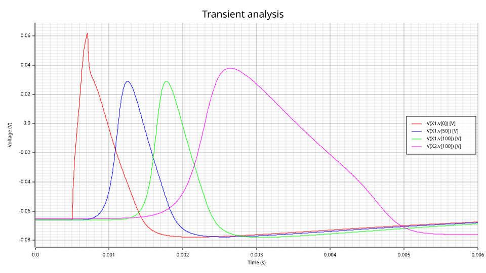

The squid giant axon with Hodgkin and Huxley's own parameters (radius 238 µm, 35.4 Ω·cm), 3 cm
in 150 compartments. Their paper computed **18.8 m/s** for it at 18.5 °C (21.2 m/s measured).
This model gives **18.97 m/s**, 0.9 % above, and is spatially converged: the same axon in 300
compartments gives 18.98 m/s, and a 2 µs step cap 19.01 m/s. The second axon, identical but at 6.3 °C, conducts at
**12.22 m/s**: its gating rates are 3.73× slower (Q₁₀ = 3), but the velocity falls by only 1.55×,
because only the channels that regenerate the spike slow down, not the cable's passive spread.
That figure is good to about 1 %: the slower spike is more sensitive to the time step, and the
same axon alone in a deck gives 12.35 m/s with a 10 µs step cap and 12.29 m/s with 2 µs.

### 2. A thin fibre under a spike train: sodium accumulates, ENa falls, spikes shrink

```bash
python docs/examples/multiphysics/hh_thin_fibre.py target/release/va-cli
```

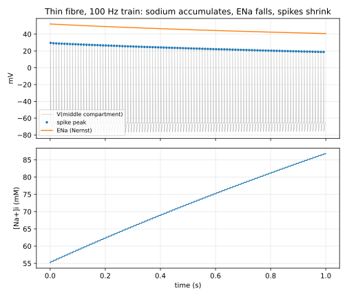

The same cable 0.25 µm in radius (1 mm, 10 compartments), driven at 100 Hz for one second with
a slow pump (τ = 10 s). The membrane admits about the same sodium per spike per unit area as the
giant axon, but each square micrometre has a/2 of axoplasm behind it, so the concentration
change is ~950× larger. Measured in the middle compartment:

| | First spike | 100th spike |
|---|---|---|
| [Na⁺]ᵢ | 55.3 mM | 86.6 mM |
| ENa (Nernst, 18.5 °C) | 52.1 mV | 40.9 mV |
| Spike peak | 29.6 mV | 18.8 mV |
| Conduction velocity | 0.577 m/s | 0.531 m/s |

The peak falls by 10.8 mV as ENa falls by 11.3 mV: the spike follows the potential its sodium
current drives toward. Two cross-checks: the first spike's velocity is the giant axon's scaled
by cable theory's √radius law (18.97·√(0.25/238) = 0.61 m/s, 5 % above with 0.1 mm compartments),
and the potassium lost (30.3 mM) balances the sodium gained (31.6 mM), as charge balance requires
of a membrane that ends the second where it started.

**What building this found.** The first spatial-convergence run, `N=300` on the deck line,
reported 37.6 m/s: the override reached the analog block's `dx = len/N` but not the vector
nets and loops elaboration had already sized for 150 compartments. 2.15.0 elaborates a module
again for any deck value it folded (see `release.txt`). The pump also has a reason to be pinned
at the operating point: in a thin fibre with a slow pump, Newton's first DC steps carried a
concentration through zero and the Nernst logarithm to NaN, so the concentrations sit at their
initial values there (`analysis("static")`), as the resting state does by definition.

**Limitations.** Extracellular space is an ideal ground (no extracellular resistance, no
external K⁺ accumulation); the pump is a first-order relaxation, not an electrogenic Na/K ATPase;
the leak carries no particular ion; squid HH kinetics are used for the thin fibre too, which no
real thin fibre has — the point is the electrodiffusion, not mammalian physiology.

---

## Power-grid swing: equal areas, relays and a cascade

**Domains:** electromechanical — rotor mechanics (a speed state per machine) and the network's
power flow — on two user disciplines: `grid`, whose potential is a bus's voltage phase angle and
whose flow is active power, and `grid_speed` for a rotor's speed deviation. **Models:**
`models/multiphysics/powergrid/grid_parts.va` (`machine`, `line`, `slack`), `grid_natures.vams`.

The classical model in per unit. A machine obeys the swing equation M ω̇ = Pm − Pe − Dω, δ̇ = ω
(a consumer is a machine with Pm < 0, as in second-order Kuramoto models of grids). A lossless
line carries B·sin(δa − δb) as a nonlinear conductance between two angle nodes, and Kirchhoff's
current law at a bus is its power balance. So the **DC operating point is the full nonlinear
load flow**, and the transient is the swing. A line is also its own protection. `@(timer)`
schedules a fault and its clearing. `@(cross(abs(P) − Pmax, +1))` is an overload relay that opens
the line and keeps it open, through an `integer` state and a `transition` breaker. `@(cross)` on
sin(Δδ) where cos(Δδ) < 0 reports every pole slip through `$strobe`.

### 1. The equal-area criterion

```bash
python docs/examples/multiphysics/grid_plots.py target/release/va-cli
```

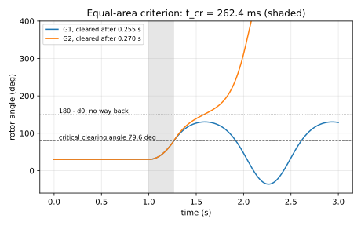

Two identical machines (H = 5 s, Pm = 0.8 pu, no damping), each on its own 1.6 pu line to an
infinite bus. At t = 1 s each line opens, so the machine accelerates with nothing to push
against. The faults are cleared after 0.255 s and 0.270 s. The textbook closed form puts the
critical clearing time at **0.2624 s**: δ₀ = 30°, critical angle 79.56°, and the rotor following
δ₀ + Pm·t²/2M while the line is open.

- G1, cleared 2.8 % early, swings to **130.39°** and back. The equal areas give 130.40°.
  Without damping it then swings between that and −36.3° indefinitely.
- G2, cleared 2.9 % late, passes 150° (180° − δ₀) with speed to spare and slips poles from
  t = 1.763 s on.
- **Bisecting the clearing time** with G1 alone puts the simulator's own critical time in
  [0.262427, 0.262430] s, against the closed form's 0.262366 s: 0.02 %, of which the 1 ms
  breaker transition is the only modelled departure from the textbook case.

### 2. A cascade: one line lost, two tripped, two islands

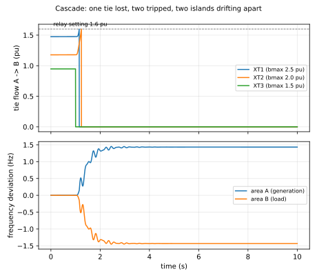

Two areas of four buses, each a ring of strong lines. Area A generates 3.6 pu and area B
consumes it, across three ties of 2.5, 2.0 and 1.5 pu capacity, each behind a 1.6 pu overload
relay. The load flow shares the transfer by strength: **1.475 / 1.178 / 0.948 pu**. At t = 1 s
a fault opens the weakest tie. The other two cannot carry 3.6 pu within their settings: T1's
relay trips at 1.149 s and T2's at 1.237 s. The areas are now islands with no governors, and
each settles where its damping absorbs the imbalance: ω = P/ΣD = 9 rad/s, **±1.4324 Hz**
(measured: ±1.4323 Hz at 10 s). From then on the open ties report pole slips as the islands
drift through each other.

**What building this found.** The first cascade run printed 98 relay trips for the two that
happened. An event site's expression was evaluated without the instance's committed state. A
relay that had opened its line through `open = 1; g = 1 − transition(open, …)` therefore saw
`open` at its seed and the line closed, and "tripped" again whenever the flow it no longer
carried would have crossed 1.6 pu. 2.16.1 passes the committed state to the event poll
(`ModelInstance::events_with_state`, `docs/interfaces.md`). The answer had been right only
because opening an open line changes nothing.

**Limitations.** Classical model: constant voltage magnitudes, no exciters or governors, lossless
lines, instantaneous relays (no inverse-time curve), and transient reactances folded into the
lines. A grid with no infinite bus takes its angle reference from a vanishing leak (`eps`) on
every machine.

---

## Thermo-optic ring bank: self-heating, crosstalk and locking

**Domains:** optical (a guided wave's power and wavelength, and each ring's intracavity field),
thermal, electrical (the heater drive). **Models:** `models/multiphysics/ringbank/ring_parts.va`
(`laser`, `ring`, `heater`, `lock`, `thermal_cap`, `thermal_res`) and `ring_natures.vams`, with
four user disciplines: `optical_power` (mW), `wavelength` (nm), `cmt_field` (a field quadrature
in √fJ) and `ring_heat` (K above the substrate, W).

Each add-drop ring is solved in coupled-mode theory, with the field written in a frame rotating
at its laser's frequency: da/dt = (iδ − 1/τ)·a + κ·s. Re a and Im a are two state nodes. The
detuning δ follows the ring's temperature through the thermo-optic effect, and half the
intrinsic loss heats the ring. The photon lifetime is **16.3 ps** and the thermal time constant
**1 ms**: one system with eight orders of magnitude between its time scales. An implicit, A-stable
integrator takes the millisecond steps anyway, where an explicit one would need picosecond steps
throughout. Neither deck needs a non-default integration method.

### 1. Self-heating: the thermal triangle and its bistability

```bash
python docs/examples/multiphysics/ring_plots.py target/release/va-cli
```

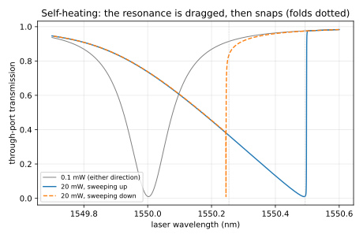

Two identical rings (loaded Q 9910) under a laser swept 1549.7 → 1550.6 → 1549.7 nm over 2 s,
at 0.1 mW and at 20 mW.

| Low-power ring | Simulated | Closed form |
|---|---|---|
| Linewidth | 0.1562 nm | 0.1564 nm |
| Through minimum | 0.00982 | 0.00982 |
| Drop maximum | 0.8116 | 0.8116 |

At 20 mW the absorbed heat drags the resonance 0.490 nm (3.1 linewidths) ahead of the laser.
The ring is 7.1416 K hot at the peak (closed form 7.1423 K).

**Bistability.** The steady states fold, so the ring is bistable for lasers between
**1550.2545 and 1550.4934 nm**. The upward sweep jumps out of resonance at 1550.4976 nm and the
downward sweep snaps back in at 1550.2456 nm, 0.004 and 0.009 nm past the folds. A sweep ten
times faster lands 0.014 and 0.033 nm past them, which is what a finite sweep rate against a
1 ms thermal lag should give.

**What this deck found.** A factor of two in the model's first version: with da/dt = −a/τ the
energy decays at 2/τ, so τ = 2Q/ω₀, not Q/ω₀. The dip depth was right, but the linewidth came out
twice too wide (0.3128 nm), which only the closed-form linewidth check could catch.

### 2. A locked WDM bank against crosstalk and self-heating

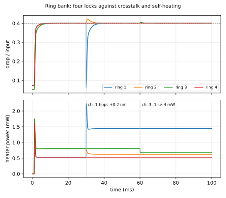

Four rings on a 0.8 nm channel grid, each made 0.25–0.30 nm blue of its laser. Neighbours are
thermally coupled at a quarter of a ring's own conductance. Each ring has a PI lock holding its
drop at 40 % of its input by driving its heater. The four lock by 6.4 ms (`$strobe` reports
each). Two disturbances follow:

- **At 30 ms channel 1 hops +0.2 nm.** Ring 1's heater rises 0.9106 mW to follow. The heat that
  leaks into ring 2 shows as a brief overshoot of its drop, and ring 2's heater backs off by
  **0.1821 mW** to cancel it. Rings 3 and 4 do not move: ring 2's lock stops the disturbance.
- **At 60 ms channel 3's power steps from 1 to 4 mW.** The drop stays at 40 % of the new input,
  and ring 3's heater gives back exactly the extra absorption, **0.1320 mW**.

With every ring held at its lock temperature the thermal network is linear, so the heater powers
have a closed form. `ring_plots.py` prints it beside the simulation for all four heaters in all
three phases, and they agree to 10⁻⁴ mW.

**What this deck found (fixed in 2.16.1).** At the 30 ms hop the dense linear solver reported this
well-posed 72-unknown system singular: the sparse solver solved it, and so did Gear and backward
Euler on the same deck. The post-solve residual test compared the raw residual with
`1e-6·(1 + ‖b‖)`. A field row with entries ~10¹¹ (1/τ and δ, in 1/s) leaves ~10⁻⁴ of round-off
after a correct factorisation, and near Newton convergence `b` is tiny. The test now measures each
row on its own scale. Results that passed before are unchanged bit for bit, since the
factorisation is the same.

**Limitations.** Linear absorption only (no two-photon or free-carrier absorption), one mode per
ring, no backscattering, lumped thermal nodes, and rings on different channels share heat but not
light. The lock acquires from the blue side only, the side a heater reaches from cold.

---

## Li-ion cell: kinetics, diffusion, aging and thermal runaway

**Domains:** electrochemical (lithium in two electrodes), electrical, thermal, and the chemistry
of film growth and decomposition. **Models:** `models/multiphysics/liion/li_parts.va`
(`electrode`, `electrolyte`, `cell_thermal`, `abuse`, `cc_load`) and `li_natures.vams`, with
three user disciplines: `stoich` (a shell's lithium stoichiometry; flow in mol/s), `cell_heat`
(K, W) and `extent` (a reaction's remaining fraction, or a film's thickness in nm).

A single-particle model. Each electrode is one representative particle, with Fick's diffusion
in the sphere discretised into ten shells. That is an RC ladder in a `generate` loop: each
shell's "capacitance" is the lithium it can hold, and each link's conductance is D·(area)/Δr.
The surface shell exchanges lithium with the electrolyte through a Butler–Volmer interface with
Arrhenius kinetics. The graphite and LiCoO₂ open-circuit potentials are the fits of Ramadass et
al. (2004). The graphite carries an SEI film that grows by a diffusion-limited side reaction,
consuming lithium and adding resistance. A separate `abuse` module adds the exothermic
decomposition reactions of thermal runaway (Hatchard et al., 2001).

### 1. Discharge at three rates

```bash
python docs/examples/multiphysics/li_plots.py target/release/va-cli
```

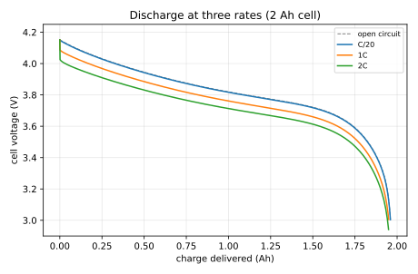

Three 2 Ah cells are discharged by a constant-current load with a 3.0 V cutoff
(`@(cross)` opens it and reports the charge delivered).

- **Closed form.** Discharged infinitely slowly, the open-circuit curve reaches 3.0 V at
  **1.9609 Ah**, where the graphite is all but empty.
- **C/20** delivers **1.9604 Ah** (−0.03 %).
- **1C and 2C** deliver 1.9558 and 1.9493 Ah, and warm the cell by 3.9 and 10.8 K on the way.

### 2. Calendar aging: two years on the shelf at 25, 45 and 60 °C

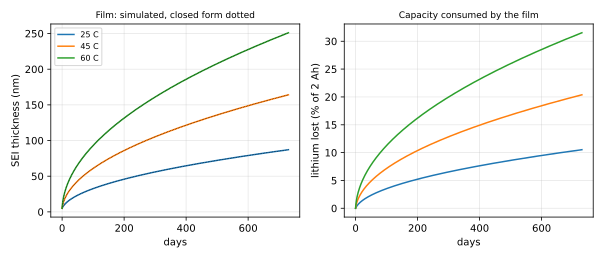

The film obeys dδ/dt = k(T)/δ, so δ = √(δ₀² + 2k(T)·t): the parabolic law of calendar aging.

| Storage | Film after 2 years (closed form) | Simulated | Lithium lost |
|---|---|---|---|
| 25 °C | 87.1415 nm | 87.1424 nm | 0.2105 Ah (10.5 %) |
| 45 °C | 164.0743 nm | 164.0769 nm | 0.4077 Ah (20.4 %) |
| 60 °C | 251.0315 nm | 251.0363 nm | 0.6305 Ah (31.5 %) |

The lithium lost, read off the graphite's stoichiometry, equals the closed form's β·S·(δ − δ₀) to
the printed digit. The run takes 648 steps of up to 10⁵ s, about one per day.

### 3. Thermal abuse: the oven test

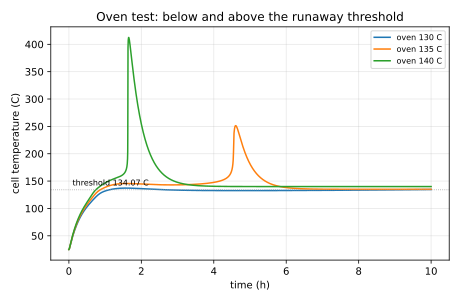

Three cells, each in an oven held at 130, 135 or 140 °C. Bisecting the oven temperature with this
model puts the runaway threshold at **134.07 °C** (407.22 K).

- **130 °C.** The cell self-heats by 7 K and settles back.
- **135 °C.** It smoulders for four and a half hours and then runs away (peak 524.5 K). By then
  the slow burn has consumed 83 % of the cathode reactant, which caps the peak.
- **140 °C.** It runs away at t = 5,846 s and peaks at 685.7 K.

This is the hard convergence case: hours at a 10 s step, then hundreds of kelvin within seconds.
The runaway time is converged in the step to 0.2 s.

**What building this found.** Two convergence problems, one in the model and one in the
simulator:

- **In the model.** Written forward, I = 2Si₀·sinh(Fη/2RT), Butler–Volmer gave the operating
  point a ~10⁵⁰ conductance at Newton's first iterate, where the cathode's η is −4.2 V. The
  model now writes the interface inverted, as V = U + (2RT/F)·asinh(I/2Si₀) with the branch
  current as the unknown.
- **In the simulator.** The codegen's junction guess limited *every* node of a module containing
  `exp` to pn-junction-sized Newton steps, the temperature node included. The Arrhenius factor
  alone was enough to trigger it. The cell temperature, starting at 0 K, would have needed about
  1,200 iterations. Since 2.16.1 the guess limits only electrical nodes.

**Limitations.** A single particle per electrode (no electrolyte concentration or potential
gradients), shell-average surface stoichiometry, no entropic heat, no lithium plating, and no
electrolyte decomposition, venting or internal short in the abuse model. The runaway threshold is
this parameter set's, not a measured cell's.

---

## Electromagnetic relay: Jiles–Atherton hysteresis, eddy currents, heating and contact bounce

**Domains:** electrical (the coil), magnetic (a hysteretic iron core and an air gap), mechanical
(the armature) and thermal (the coil). **Models:** `models/multiphysics/relay/relay_parts.va`
(`relay_coil`, `armature`, `coil_thermal`) and `relay_natures.vams`, with four user disciplines:

- `magfield`: the core's H and M in A/m, as state nodes;
- `mech`: the armature's position, with force as the flow;
- `mech_v`: its velocity;
- `coil_heat`: the coil's temperature and heat.

**The coil and core.** The coil is written as V = R(T)·i + N·dΦ/dt. Ampère's law closes the
magnetic circuit through the core (H·l_c) and an air gap g₀ − x that the armature's travel x
closes. A classical lamination eddy-current term is available (`ke`). The core's magnetization
follows the Jiles–Atherton model, with both of its switches smoothed so that the right-hand side
is continuous:

- the direction of change, sign(dH/dt), is taken from a lagged copy of H rather than from a
  differentiated one;
- the irreversible term's on/off gate.

**The armature.** It is pulled by Φ²/(2μ₀A) against a preloaded spring. It rests on a backstop
and closes onto the pole face, both Hertzian contacts.

### 1. The core's B–H loop, and the energy it dissipates

```bash
python docs/examples/multiphysics/relay_plots.py target/release/va-cli
```

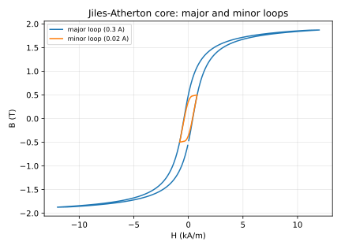

Two closed cores, each driven with a 50 Hz current:

| Drive | Peak B | Remanence | Coercivity | Loop area × volume | ∮(V − R·I)·I dt |
|---|---|---|---|---|---|
| 0.3 A (major loop, into saturation) | 1.8718 T | 0.570 T | ±383 A/m | 3.0219 mJ | 3.0218 mJ |
| 0.02 A (minor loop) | 0.5004 T | 0.362 T | ±375 A/m | 0.67668 mJ | 0.67669 mJ |

- **Saturation.** The major loop's 1.8718 T at 12 kA/m sits just under the anhysteretic
  1.8765 T there, as a lagging magnetization should.
- **Coercivity.** For small α the model's coercivity is close to its pinning parameter, here
  k = 400 A/m.
- **Energy.** What the coil takes in and does not burn in its own resistance is the loop's
  energy, cycle by cycle.

### 2. Pickup, hot pickup, bounce, release, and remanence that will not let go

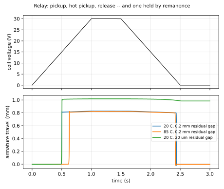

Three relays share one coil voltage, which ramps 0 → 30 V → 0. Two have a 0.2 mm residual gap
(the non-magnetic shim on a pole face), one at 20 °C and one at 85 °C. The third has a 20 µm gap.

- **Pickup.** The armature leaves its backstop when Φ²/(2μ₀A) reaches the 0.2 N preload, at
  B = √(2μ₀F/A) = **0.15853 T**, whatever the core does. Every coil reports **0.1588 T** at
  lift-off.
- **Hot pickup.** The current that takes, 73.2 mA, is the same hot or cold. The voltage is not:
  14.66 V at 20 °C and 18.39 V at 85 °C, a ratio of 1.2547 against the coils' resistance ratio
  of 1.2555.
- **Bounce.** The armature closes about 16 ms after lift-off and bounces once.
- **Release.** At 1.88 V (cold) and 2.46 V (hot).
- **Remanence.** The 20 µm relay never releases. With so little air in the closed circuit, the
  core's remanence holds the armature shut at zero current, which is why real relays carry that
  shim.

**What building this found.** All in the model:

- **A sign error in the backstop's contact damping:** −b·v instead of +b·v, so energy was pumped
  in while the armature rested on the stop. Backward Euler's numerical damping hid it, and for
  a while it looked like a trapezoidal-rule instability: it was not.
- **The rate-dependence of a smoothing scale.** The smoothed sign(dH/dt) made the loop depend on
  the drive's speed until the scale (`hs`) was set well below any real dH/dt. At the first
  value, the pickup current moved 0.9 % with the coil's resistance.
- **The Jiles–Atherton denominator** δk − α(M_an − M) can reach zero, an infinite
  susceptibility, for parameter sets outside the model's range. The model holds it at 5 % of k.

**Limitations.** A single lumped magnetic path (no leakage or fringing), the classical
eddy-current term only, scalar hysteresis, and Jiles–Atherton's known non-closure of small
minor loops.

---

## Gray–Scott reaction–diffusion: a pattern-forming grid

**Domain:** chemical kinetics on a grid. **Models:** `models/multiphysics/grayscott/gray_scott.va`
and `rd_natures.vams`: a user `reactant` discipline whose potential is a concentration.

du/dt = D_u∇²u − uv² + F(1 − u), dv/dt = D_v∇²v + uv² − (F + k)v, on an N×N periodic grid, as
a circuit:

- each cell has two nodes, u and v;
- the reaction is a nonlinear current to ground;
- the five-point Laplacian is conductances D/h² to the four neighbours, wrapping at the edges.

The grid is two-dimensional vector nets, `reactant [0:N-1][0:N-1] u, v`, built by nested
`generate` loops. Pearson's initial state (a seeded square with a fixed ±1 % perturbation) is
pinned at the operating point with `analysis("static")`. The model writes the whole grid to
`target/gray_scott.txt` at the start, every `tsnap` and at the end, with
`@(initial_step or timer(tsnap, tsnap) or final_step)`: an event `or` list, which 2.16.0 added
for this example.

### 1. The well-mixed reactor, against its steady states

```bash
va-cli sim circuits/multiphysics/gray_scott_wellmixed.net --model models/multiphysics/grayscott --tran --report X1.u[0][0],X1.v[0][0],X2.u[0][0],X2.v[0][0]
```

With every cell alike, nothing diffuses and each cell is the same stirred reactor. For
F = k = 0.04 the closed form has three steady states:

| State | (u, v) | Stability |
|---|---|---|
| trivial | (1, 0) | stable |
| middle | (0.8, 0.1) | a saddle |
| upper | (0.2, 0.4) | a stable focus |

A cell started at (0.3, 0.35) ends at **(0.200000, 0.400000)**. One started at (0.9, 0.05), on
the other side of the saddle's separatrix, decays to **(1.000000, 3.6·10⁻⁷¹)**. The reactor is
bistable.

### 2. Self-replicating spots

```bash
python docs/examples/multiphysics/gray_scott.py gray_scott_spots target/release/va-cli
```

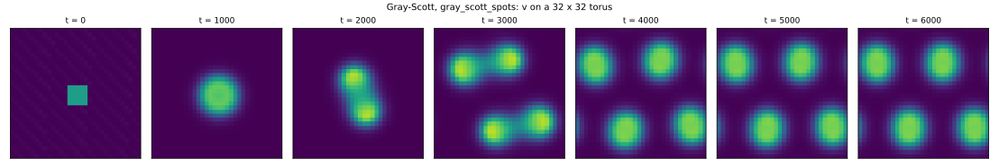

Pearson's "mitosis" parameters (F = 0.0367, k = 0.0649, D_u = 2·10⁻⁵, D_v = 10⁻⁵) on a 32×32
torus of side 0.32, which is his resolution. That is 2049 unknowns, solved sparse. The seeded
square rounds into one spot, which divides into two by t = 2000 and four by t = 3000. The four
tile the torus and the pattern then settles: mean v 0.09133 at t = 4000 and 0.09166 at 6000.

- **Step cap.** The deck caps the step at 20 s. A 5 s cap gives the same pattern (mean v 0.09161
  against 0.09161, max v 0.36331 against 0.36333 at t = 5000) in 225 s instead of 97.
- **Cost.** The run takes about a minute and a half. The grid is one instance, so the parallel
  evaluation of instances has nothing to share out.

**Limitations.** Second-order finite differences on a uniform grid. Grids much beyond 64×64 are
slow, since the whole grid is one model instance. The step is set by accuracy, not by the
explicit stability limit a dedicated pattern-formation code would use.
