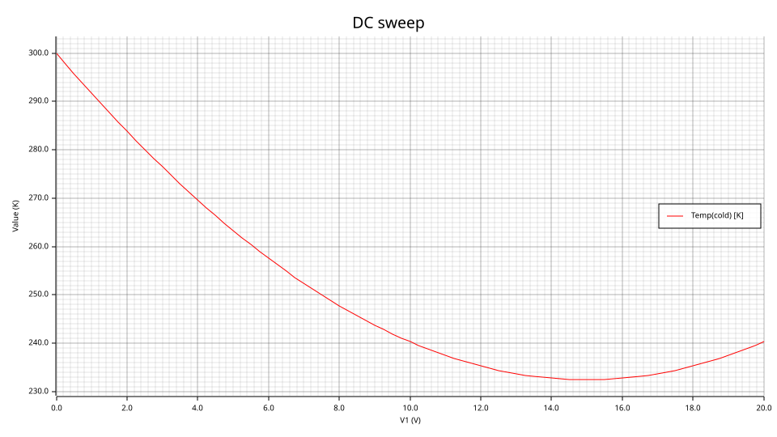
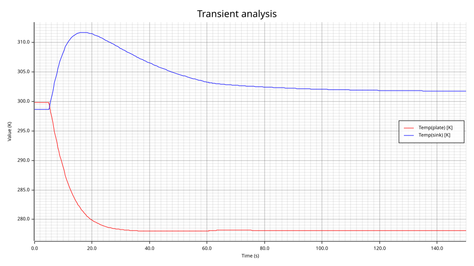
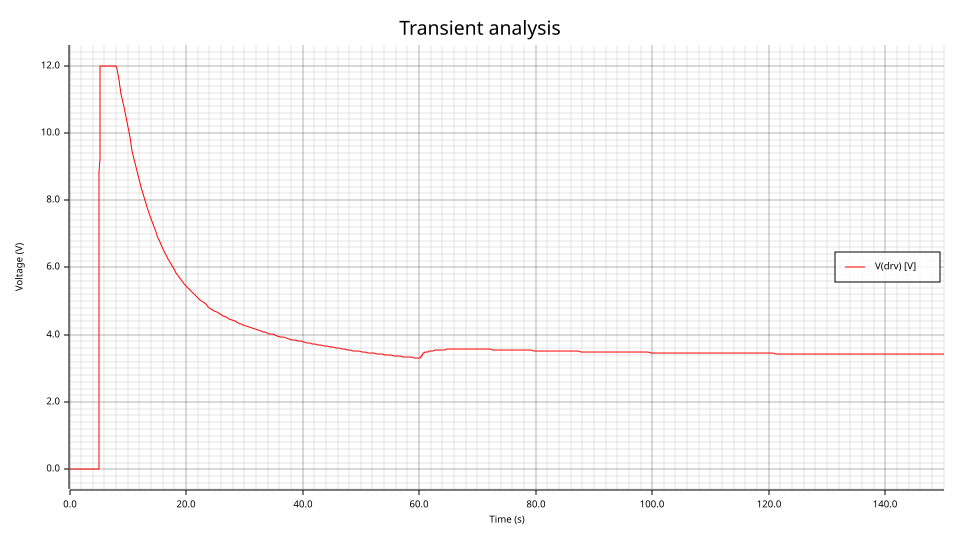
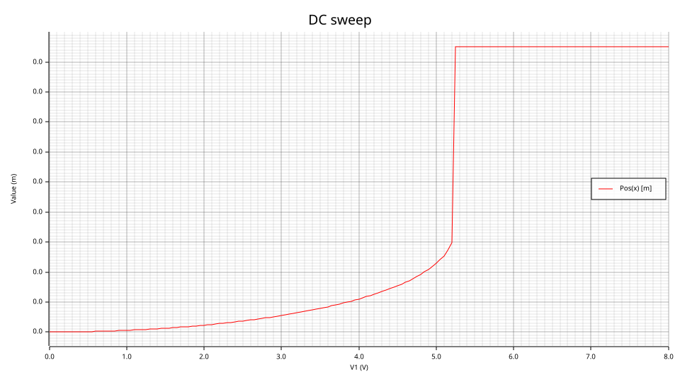
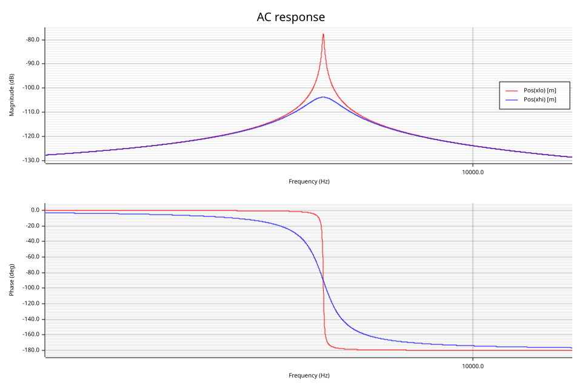
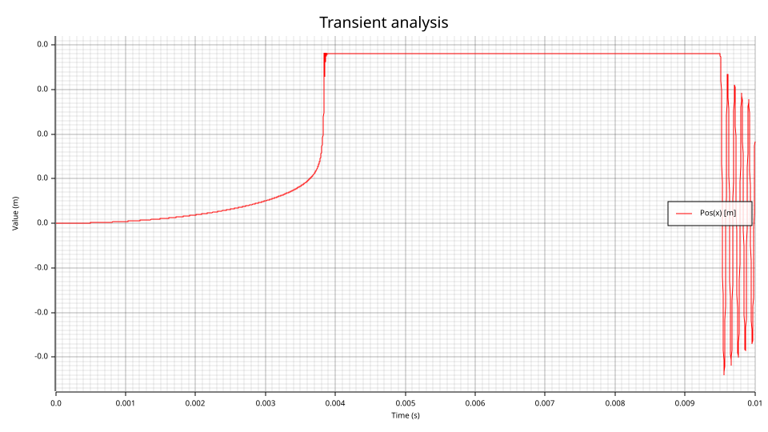
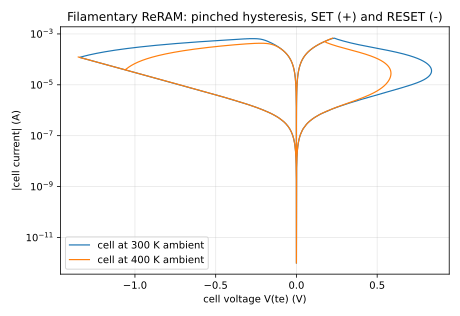
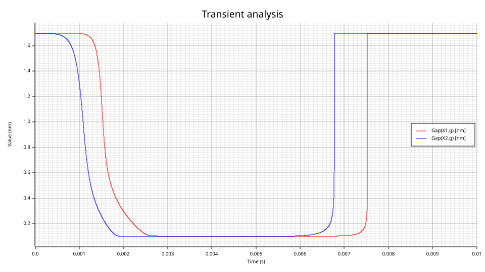
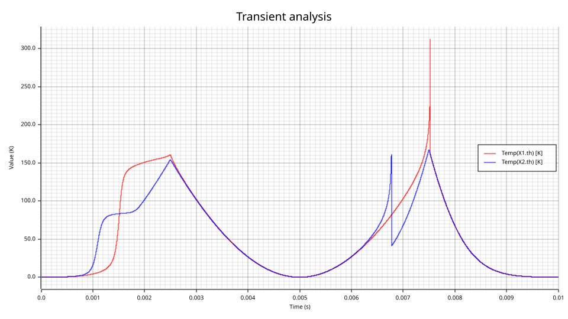
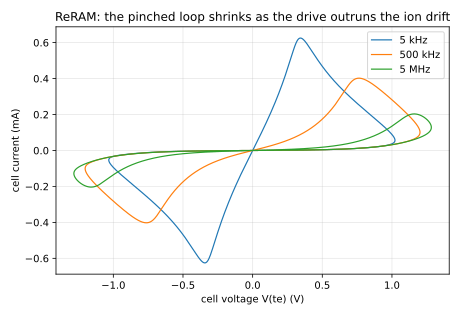

# Multiphysics examples

One solution vector, many physical domains. Each example below couples two or more disciplines
— electrical, thermal, mechanical, magnetic, optical, chemical, acoustic, fluidic — through
Verilog-A models written for it, and each is chosen to exercise a different part of the
language and of the simulator. They live in `models/multiphysics/<example>/` (the models, and
the `nature`/`discipline` declarations they need) and `circuits/multiphysics/` (the decks), and
every deck's header says what the run should show and the closed-form numbers to check it
against.

**What these are, and are not.** Demonstrations, checked against closed-form results and
conservation laws where one exists (each says which). They are not validated against a
reference simulator the way the decks under `golden/` are: QSPICE cannot run these models, and
nothing here claims a tolerance it has not measured.

Every command is reproducible as written from the repository root.

## Verilog-A coverage

Which language features each example uses, so the set as a whole reads as a coverage map.

| Construct | Examples |
|---|---|
| user `nature` / `discipline` declarations | [TEC](#peltier-cooler-under-pid-control), [MEMS](#electrostatic-mems-pull-in-damping-contact-and-stiction), [ReRAM](#filamentary-reram-filament-growth-joule-heating-arrhenius-drift) |
| several disciplines in one module | [TEC](#peltier-cooler-under-pid-control), [MEMS](#electrostatic-mems-pull-in-damping-contact-and-stiction), [ReRAM](#filamentary-reram-filament-growth-joule-heating-arrhenius-drift) |
| `analog function` | [TEC](#peltier-cooler-under-pid-control), [MEMS](#electrostatic-mems-pull-in-damping-contact-and-stiction), [ReRAM](#filamentary-reram-filament-growth-joule-heating-arrhenius-drift) |
| ranged parameters (`from`, `exclude`) | [TEC](#peltier-cooler-under-pid-control), [MEMS](#electrostatic-mems-pull-in-damping-contact-and-stiction), [ReRAM](#filamentary-reram-filament-growth-joule-heating-arrhenius-drift) |
| `ddt` | [TEC](#peltier-cooler-under-pid-control), [MEMS](#electrostatic-mems-pull-in-damping-contact-and-stiction), [ReRAM](#filamentary-reram-filament-growth-joule-heating-arrhenius-drift) |
| `laplace_nd` | [TEC](#peltier-cooler-under-pid-control) |
| `transition` | [TEC](#peltier-cooler-under-pid-control) |
| internal nodes as state variables | [TEC](#peltier-cooler-under-pid-control), [MEMS](#electrostatic-mems-pull-in-damping-contact-and-stiction), [ReRAM](#filamentary-reram-filament-growth-joule-heating-arrhenius-drift) |
| `@(timer)` | [TEC](#peltier-cooler-under-pid-control) |
| `@(cross)` with a direction | [TEC](#peltier-cooler-under-pid-control), [MEMS](#electrostatic-mems-pull-in-damping-contact-and-stiction), [ReRAM](#filamentary-reram-filament-growth-joule-heating-arrhenius-drift) |
| `$strobe`, `%m` | [TEC](#peltier-cooler-under-pid-control), [MEMS](#electrostatic-mems-pull-in-damping-contact-and-stiction), [ReRAM](#filamentary-reram-filament-growth-joule-heating-arrhenius-drift) |
| `.op`, `.dc` sweep, `.tran` | [TEC](#peltier-cooler-under-pid-control), [MEMS](#electrostatic-mems-pull-in-damping-contact-and-stiction) |
| `ddt` of a nonlinear charge (`d/dt[C(x)V]`) | [MEMS](#electrostatic-mems-pull-in-damping-contact-and-stiction) |
| a coefficient times `ddt` | [MEMS](#electrostatic-mems-pull-in-damping-contact-and-stiction) |
| event variables persisting across events (bounce counter) | [MEMS](#electrostatic-mems-pull-in-damping-contact-and-stiction) |
| `.ac` small-signal analysis | [MEMS](#electrostatic-mems-pull-in-damping-contact-and-stiction) |
| `@(above)` | [ReRAM](#filamentary-reram-filament-growth-joule-heating-arrhenius-drift) |
| `analysis("static")` (DC-only initial condition of a state) | [ReRAM](#filamentary-reram-filament-growth-joule-heating-arrhenius-drift) |
| `$bound_step` | [ReRAM](#filamentary-reram-filament-growth-joule-heating-arrhenius-drift) |
| `SIN` / `PWL` sources driving a model | [ReRAM](#filamentary-reram-filament-growth-joule-heating-arrhenius-drift) |

---

## Peltier cooler under PID control

**Domains:** electrical, thermal (absolute temperature). **Models:**
`models/multiphysics/tec/` — `tec.va` (the module), `thermal_parts.va` (heat capacity,
thermal resistance, ambient, stepped heat load), `pid.va` (controller), `tec_natures.vams`
(the `thermal_abs` discipline: kelvin above 0 K, watts).

The thermoelectric module carries all four thermoelectric effects. The Seebeck coefficient
depends on temperature, α(T) = α₀ + α₁(T − 300 K), and from that one assumption everything
else follows consistently:

- the Seebeck EMF is ∫α dT between the faces, so the electrical side sees I = (V − ∫α dT)/R;
- each junction pumps Peltier heat Π·I with Π = α(T)·T at its own temperature;
- Joule heat I²R returns half to each face, conduction K·ΔT leaks back;
- the **Thomson** heat I·∫T dα/dT dT is what is left over, absorbed in the legs.

That last term is not an extra assumption but the bookkeeping that makes the energy balance
close: heat out of the hot face equals heat pumped from the cold face plus electrical power,
exactly. The controller is a PID with a filtered derivative and back-calculation anti-windup,
closing at `ton` through `@(timer)` and ramping in with `transition`.

### 1. Maximum temperature difference — DC sweep against the closed form

```bash
va-cli sim circuits/multiphysics/tec_dtmax.net --model models/multiphysics/tec --report cold --plot docs/examples/multiphysics/tec_dtmax.svg
```



Constant α and R, hot face at 300 K, cold face insulated, drive swept 0–20 V. The cold face is
coldest where the extra heat pumped by more current equals the extra Joule heat it brings,
I = α·T_c/R, and the closed form gives **T_c = 232.455 K (ΔT = 67.545 K) at 5.811 A, 15.00 V**.
The sweep's minimum is **232.4555 K at 15.00 V, 5.8114 A**. Past it the cold face warms again.

### 2. Energy audit — operating point

```bash
va-cli sim circuits/multiphysics/tec_energy.net --model models/multiphysics/tec
```

The full model (Thomson effect and 0.4 %/K resistance tempco on) at 5 V between two thermal
resistances to ambient: Q_c = 10.2223 W pumped, P_e = 9.7547 W electrical, Q_h = 19.9769 W
rejected, **Q_h − Q_c − P_e = −2.5·10⁻⁶ W**, the print precision. The Thomson heat in this
balance is 1.44 W; drop it from the model and the books are off by that much.

### 3. Closed-loop regulation through a load step — transient

```bash
va-cli sim circuits/multiphysics/tec_pid.net --model models/multiphysics/tec --tran --report plate,sink --plot docs/examples/multiphysics/tec_pid_temps.svg
va-cli sim circuits/multiphysics/tec_pid.net --model models/multiphysics/tec --tran --report drv --plot docs/examples/multiphysics/tec_pid_drive.svg
```




A 20 J/K plate under a 1 W load, held at 278.15 K (5 °C) by the PID; the module's hot face
on a 50 J/K sink, 0.5 K/W to a 298.15 K ambient. The run starts from the uncooled steady state
(plate 299.79 K). What it shows:

1. The loop closes at 5 s and the drive saturates at the 12 V rail for a second; the plate
   falls 21.6 K and enters the 0.1 K band at **t = 30.86 s**, reported by the model's
   `@(cross)`, without undershooting the setpoint: the back-calculation term bled the
   integrator while the output was clamped.
2. The sink warms to 311.7 K under the pumped heat plus the electrical power, then relaxes as
   the drive falls to ~3.4 V; the temperature difference the module must hold changes with it.
3. At 60 s the load steps to 3 W (`@(timer)` + `transition`, reported by `$strobe`); the plate
   rises by 0.18 K, the drive rises to answer it, and the integrator brings the plate back
   toward 278.15 K (278.147 K at 150 s, still closing).

**Limitations.** Lumped faces (no temperature profile in the legs; the Thomson heat is split
half and half), temperature-independent K, an ideal voltage-driven supply.

---

## Electrostatic MEMS: pull-in, damping, contact and stiction

**Domains:** electrical, mechanical (position-as-potential: force is the flow, so a node's
Kirchhoff sum is Newton's law), thermal (a thermoelastic mode). **Models:**
`models/multiphysics/mems/mems_parts.va` — composable parts on one mechanical node: `proof_mass`
(inertia, velocity as an internal node), `spring`, `es_gap` (parallel-plate transducer over a
dielectric layer: charge `d/dt[C(x) V]` and force εAV²/2g²), `squeeze_film` (gap-cubed gas
damping with rarefaction), `thermoelastic`, `contact` (Hertzian landing plus adhesion) —
and `mems_natures.vams`.

A 100 µm square plate, 2 µm over an electrode covered by 0.1 µm of dielectric, on a 1 N/m
spring (10 kHz). Thermoelastic damping is not a fitted Q: the plate is coupled to a thermal mode
(force −γθ on the plate, heat γT₀ẋ into the mode, relaxing with τ = 15.9 µs), and Zener's
frequency-dependent damping comes out of the circuit.

### 1. Pull-in — DC sweep against the closed form

```bash
va-cli sim circuits/multiphysics/mems_pullin.net --model models/multiphysics/mems --report x --plot docs/examples/multiphysics/mems_pullin.svg
```



The static balance kx = εAV²/2(g_e − x)² (g_e = 2.0133 µm, the dielectric included) has a
stable branch only up to **V_PI = √(8k g_e³/27εA) = 5.2259 V** at x = g_e/3. The sweep matches the
closed form at every point checked — 0.045741, 0.220332, 0.456840 µm at 2, 4, 5 V, to the
printed digits — and jumps onto the dielectric stop between 5.20 and 5.25 V.

### 2. Resonance under bias, at two pressures — AC

```bash
va-cli sim circuits/multiphysics/mems_resonance.net --model models/multiphysics/mems --ac --report xlo,xhi --plot docs/examples/multiphysics/mems_resonance.svg
```



Biased at 3 V, the electrostatic spring softens the plate by εAV²/g³ = 0.1156 N/m, and the
thermoelastic coupling stiffens it by γ²T₀R·ω²τ/(1+ω²τ²) = 4.7·10⁻⁴ N/m: the resonance moves from
10006 Hz to **9412.55 Hz**, which is where both packages peak. The damping differs: at 1 Pa the
rarefied gas barely damps (Q_squeeze ≈ 17000) and thermoelastic loss limits **Q to 1605**; at
100 Pa the squeeze film dominates, **Q = 78.2**. Both match the models' equations (1605.2 and
78.2 measured).

This check found a sign error in the first draft of `thermoelastic`: with the compression heat
entered as a sink rather than a source, the coupling pumped energy into the motion, and Q came
out 1973 instead of 1605 — exactly what negative thermoelastic damping predicts.

### 3. Pull-in, bounce, stiction and release — transient

```bash
va-cli sim circuits/multiphysics/mems_hysteresis.net --model models/multiphysics/mems --tran --report x --plot docs/examples/multiphysics/mems_hysteresis.svg
```



A slow 0 → 7 → 0 V triangle at 100 Pa. The plate lands at 5.38 V (V_PI plus the ~0.1 ms snap),
**bounces 48 times** on the Hertzian contact while it rings down, sticks, and releases only at
**0.7038 V** — against the closed form √(2g_c²(kx_c − f_a)/εA) = 0.7023 V. In contact the gap
is the 0.1 µm dielectric, so the same voltage pulls ~316 times harder, and the 0.2 µN adhesion
moves release from 0.742 V down to 0.702 V. The `contact` model's events report the landing,
count the bounces, and report the release.

**Limitations.** One rigid plate (no plate bending, no fringing fields), the squeeze film at low
squeeze number (no gas spring), a lumped single-mode thermoelastic coupling, an ideal voltage
drive.

---

## Filamentary ReRAM: filament growth, Joule heating, Arrhenius drift

**Domains:** electrical, thermal (the filament's temperature rise), and the filament itself — a
user `gap_disc` discipline whose potential is the gap in nanometres. **Models:**
`models/multiphysics/reram/reram.va`, `reram_natures.vams`.

The cell's state is the gap g between the filament tip and the electrode (a Stanford–PKU-type
model): the current tunnels across it, I = i₀·e^(−g/g₀)·sinh(V/v₀), and the gap moves by
thermally activated, field-driven ion drift,
dg/dt = −ν₀·e^(−Eₐ/kT)·sinh(γa₀V/(t_ox·kT)), with T the filament's own temperature: ambient
plus the rise its Joule heat V·I drives through a 1 MK/W thermal resistance. The gap is a state
node pinned to its initial value at the DC point (`analysis("static")`), the switching events
are reported by `@(above)` and `@(cross)`, and a fast-moving gap asks for short steps through
`$bound_step`.

### 1. SET, RESET and temperature — triangular sweep at two ambients

```bash
va-cli sim circuits/multiphysics/reram_sweep.net --model models/multiphysics/reram --tran --report X1.g,X2.g --plot docs/examples/multiphysics/reram_gap.svg
va-cli sim circuits/multiphysics/reram_sweep.net --model models/multiphysics/reram --tran --report X1.th,X2.th --plot docs/examples/multiphysics/reram_temp.svg
python docs/examples/multiphysics/reram_iv.py target/release/va-cli
```





Two cells behind 2 kΩ, swept 0 → +1.6 → −1.6 → 0 V in 10 ms, one at 300 K and one at 400 K.

- **SET is self-limiting.** The gap starts closing at 0.641 V (filament at 413 K) but the
  series resistor takes a growing share of the voltage as the cell conducts — the current
  compliance — and the gap closes from 1.5 to 0.3 nm over 0.58 ms of the ramp.
- **RESET is abrupt and thermal.** It waits until the low-resistance cell carries enough current
  to heat its filament to ~610 K (at −0.830 V), and then the opening cell takes the voltage back
  from the resistor: the gap reopens from 0.3 to 1.5 nm in **10.5 µs**, 1/700 of the ramp.
- **Arrhenius.** The 400 K cell switches at 0.507 V / −0.696 V: e^(−Eₐ/kT) is 1,412 times
  larger at its starting temperature (Eₐ = 0.75 eV).
- **The loop is pinched**: I = 0 whenever V = 0, whatever the state.

A model with the field-enhancement factor twice as large (γ = 16) switched in under a
picosecond at the end of RESET, and no time step could follow it; the value used here (γ = 8)
keeps the physics and the time scales resolvable. The run is converged in its step size: SET and
RESET voltages agree to 0.5 mV between 1 µs and 0.2 µs maximum steps.

### 2. The frequency fingerprint — the loop shrinks as the drive outruns the drift

```bash
python docs/examples/multiphysics/reram_loops.py target/release/va-cli
```



The same cell on ±1.6 V sinusoids (decks `reram_freq_5k`, `_500k`, `_5meg`, two periods each;
the second is kept). A memristor's defining signature (Chua) is a pinched loop whose lobes
shrink as the frequency grows, because the state cannot follow a fast drive. Measured, with the
two lobes integrated separately (they are traversed in opposite directions, so one signed
∮I dV would cancel them):

| Drive | Gap range over a cycle | Lobe areas (V·A) |
|---|---|---|
| 5 kHz | 0.238 – 1.697 nm | 3.19·10⁻⁴ + 3.20·10⁻⁴ |
| 500 kHz | 0.759 – 1.687 nm | 2.19·10⁻⁴ + 2.18·10⁻⁴ |
| 5 MHz | 1.326 – 1.688 nm | 5.8·10⁻⁵ + 5.8·10⁻⁵ |

Below ~5 kHz the cell still switches completely every cycle (at 50 Hz and 500 Hz the gap spans
the full 0.1 – 1.7 nm); exponential kinetics only move the switching to a higher voltage. The
loop starts to collapse once a half period is comparable with the SET time.

**Limitations.** One lumped filament: no variability, no filament radius, no read noise; a
constant field-enhancement factor; the thermal node is the filament's own.
